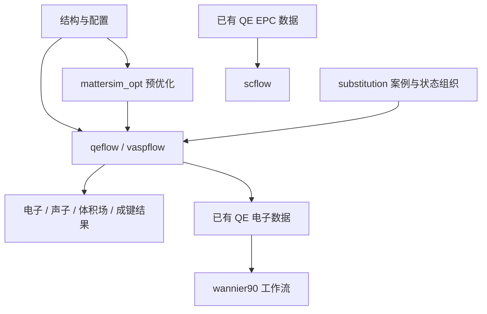

# DFTFlow 当前功能与 CLI 手册

## 项目说明

DFTFlow 为第一性原理计算准备输入、组织外部求解器和调度任务，并整理电子、声子、成键及超导结果。本总览按功能家族组织，每个公开 CLI 有独立功能与用法页；以当前源码和已留档验收为依据，不将历史迁移计划当作当前能力。

## 功能目录

| 功能家族 | 职责 | 程序与主要依赖 |
| --- | --- | --- |
| [qeflow](qeflow/README.md) | QE 电子、声子、分 q 自动链与后处理 | qeflow；QE、按需 Slurm/VASPKIT |
| [vaspflow](vaspflow/README.md) | VASP 输入、优化、电子/体积场/COHP 分析 | vaspflow；按需 VASP/VASPKIT/LOBSTER |
| [wannierflow](wannierflow/README.md) | Wannier 初始化、能窗与结果分析 | 家族命令 wannier90；Wannier90 与 QE 接口 |
| [scflow](scflow/README.md) | 已有 QE EPC 数据的超导后处理 | scflow；Rust 数值与绘图库 |
| [epwflow](epwflow/README.md) | 八阶段编号目录、当前配置增量续算、并行预检、原生谱与数值告警 | Rust epwflow；原生两模式执行、续算及结果包已有回归，MgB₂ Tc 与完整链路尚未验收 |
| [substitutionflow](substitutionflow/README.md) | 元素替换、阶段组织、批量汇总 | substitution；调用其他 flow |
| [mattersimflow](mattersimflow/README.md) | 机器学习势预优化 | Python mattersim_opt；MatterSim/ASE |
| [独立工具](tools/README.md) | 独立 Rust dyn0 算法工具 | qf-gen-dyn0；单独 Cargo 工程 |

家族 README 列出全部直属命令；每页提供功能、参数、命令示例、输入输出、限制和源码依据。`--help` 可查看安装版本的实际参数。CLI 页数与安装入口数不同：同一功能的兼容命令和家族子命令共用一页，家族独有子命令另外列出。

## 关键入口

- [三种声子模式、dyn0 来源、目录和一次提交链（0006）](qeflow/phonon-workflow.md)。
- [只用 QE 初始化生成 dyn0](qeflow/qe_ph_nosplit.md) 与 [独立 Rust dyn0 工具](tools/qf-gen-dyn0.md)。 初始化输入和日志的位置见 [文件问答](qeflow/phonon-workflow.md#dyn0-初始化文件问答)。
- [Rust 架构、平台构建与安装](dftflow-rust.md)。
- [声子绘图旧入口](qe-phonon-plot.md)、[scflow 旧入口](scflow.md)：保留链接，具体用法由家族页面维护。

- [epwflow 实际拟合外窗、比较诊断与测试数据目录](epwflow/README.md#实际解纠缠外窗与测试目录)：已支持按实际 Wannier 外窗重绘；宽窗缺态和暂缓投影保留；声子新 50／20 门已复核通过，真实 Tc 尚未验收。

## 整体关系

DFTFlow 的流程包装不替代 QE、VASP 等求解器；选择某个家族不意味着自动运行图中全部流程。特别是普通声子计算不自动产生 scflow 所需的 EPC 数据。

## 使用前需知道的当前边界

分 q index/coords 已有完整自动依赖链。nosplit 算例通过显式作业脚本完成，其直接聚合 -r/-s 路径仍有已记录缺口。VASP 能带路径生成、Wannier post 的 run/submit 差异及 substitution 的部分跨命令参数不匹配，均在相应页面明确说明。

本目录描述默认值和有效接口；命令示例中的路径、结构、费米能与网格须换成实际输入。-r 在现有资源中计算，-s 申请队列任务；纯后处理通常直接执行。不得仅凭提交返回成功或生成了输入文件判定计算完成。

DFTFlow 自有任务脚本生成器及跟踪的构建、安装、自测脚本不自动开启 `set -euo pipefail`，也不拆分开启这些严格选项；关键失败通过显式退出码判断处理。用户配置的 Slurm header 原样保留，已冻结的历史运行脚本不自动改写。范围与验证见 [0019 验收](../specs/0019-shell-script-options/acceptance.md)。

自动生成的 Slurm 日志指令使用简短文件名，EPW 保留 `%j` 和阶段命名，Wannier90 保留原默认名字；通过 `#SBATCH --chdir` 将日志固定在对应脚本目录，支持从其他目录提交。正文另行保持实际科学工作目录。用户自定义 header 和已冻结的历史脚本不自动修改；源码修复不等于已有二进制已更新。范围与验证见 [0022 验收](../specs/0022-slurm-log-filenames/acceptance.md)。

## 文档维护与证据

本轮依据当前源码和 [0006 验收](../specs/0006-qe-phonon-submit-chain/acceptance.md) 回写，覆盖后续 dyn0 工具拆分及全量重新编译的事实。[0004](../specs/0004-dftflow-rust/spec.md) 提供迁移背景；其他 Feature 由命令页链接。

Overview 只维护当前功能事实，不承担 Issue/任务状态管理。CLI 总览重写阶段仅修改 docs/overview、未运行程序测试或提交；后续代码变更的验证与交付另见相应 Feature 验收记录。0006 的默认 outdir 统一为 ./tmp，显式配置优先，已有结果保留。实际机器配置、软件路径和原始运行证据仍保存在本地忽略目录；这里不复制它们。

编号 QE／EPW 工作区的电子参考支持 PW、bands、DOS 各任务校验和失败局部恢复；bands／DOS 各自启用 pencil 分解，重提旧作业脚本会提示公开命令生成新尝试；并行启动及旧数据接入边界见 [EPW 总览](epwflow/README.md#编号工作区的电子后处理续算)。

独立 Wannier 输入及独立 W90／postw90 数据衔接、零退出错误检查、后处理失败保留拟合证据和并发命令锁诊断见 [EPW 总览](epwflow/README.md#编号工作区的电子后处理续算)与 [0023 验收](../specs/0023-epw-wannier-native-start/acceptance.md)。

EPW 运行记录使用可见的 `epw-state/` 和阶段本地 `completion.json`；删除阶段后可重建并使下游失效，旧编号状态显式迁移，预算绑定保留。目录及兼容边界见 [EPW 总览](epwflow/README.md#可见运行状态与阶段删除后的恢复)与 [0025 验收](../specs/0025-epw-visible-run-state/acceptance.md)。0025 当时未切换默认安装或迁移真实现场；0027 后续规范更新 bin/epwflow 并在用户指定子目录实测。

编号声子后处理支持严格重验后的 PH 响应复用，避免 dyn0 自复制截断；阶段归档保留当前 Slurm 日志的持续写入入口。源码、安装及本轮指定 MgB₂ 工作区的真实边界见 [0027 验收](../specs/0027-mgb2-epwflow-example-debug/acceptance.md)。
