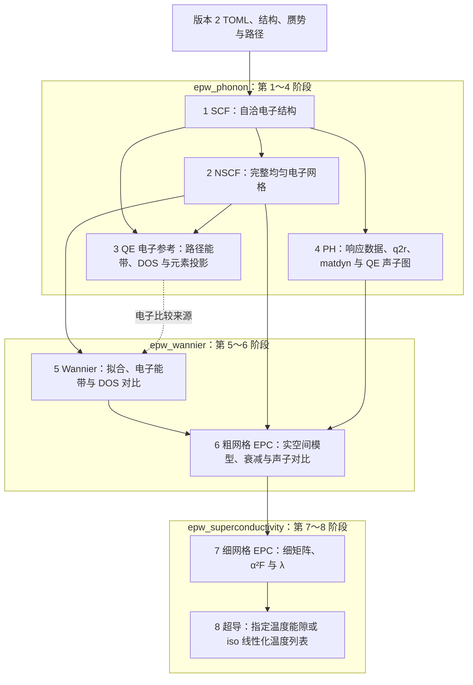
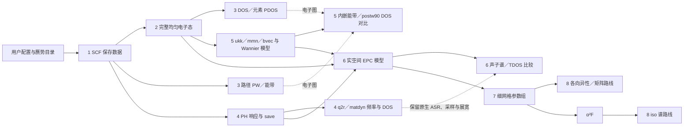
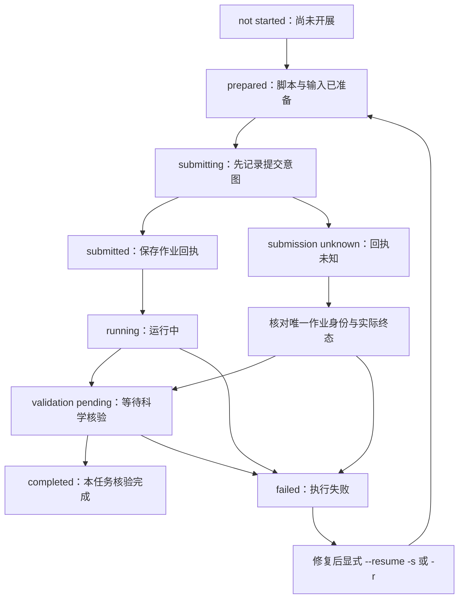

# EPW 工作流架构总览

当前版本：编号工作区（`schema_version = 2`）

最后更新：2026-11-17

[返回 EPW 总览](README.md) · [完整流程与操作](workflow.md) · [直接文件接续](preflight-and-reuse.md)

## 八阶段与三个程序

EPW 将电子结构、声子、Wannier 插值和超导求解分为八个独立阶段。
编号表示职责和目录位置，不表示所有计算必须串行依赖前一编号。
用户按实际依赖运行目标；当前指定阶段不自动补算上游，直接输入缺失时报告路径并停止。



第 5 步不依赖声子；第 6 步不读取第 5 步电子曲线，也不生成电子声子四面板总览。
第 8 步 iso 谱路线可以仅取已有 α²F，不要求回查第 1～6 步；各向异性需要细矩阵。
图中箭头表达数据依赖，不代表自动提交或自动补齐前序阶段。

| 阶段 | 依赖阶段 | 主要计算与交付 | 当前提交方式 |
| --- | --- | --- | --- |
| 1 SCF | 无前序阶段 | 电子自洽、保存 XML 与逐带范围诊断 | 单原生任务 |
| 2 NSCF | 1 | 完整均匀点表、电子态与逐带范围诊断 | 单原生任务 |
| 3 QE 电子参考 | 1（路径 PW）、2（DOS／投影） | PW 路径、bands、DOS／PDOS、电子组合图 | 单阶段分配自动后处理与出图 |
| 4 PH | 1 | 所选 nosplit／coords／index 响应、save、力常数与声子图 | 单阶段分配推进本阶段子任务 |
| 5 Wannier | 2；电子对比另取 3 | 原生拟合、内嵌能带与 postw90 DOS、电子对比图 | 单阶段分配自动核验与出图 |
| 6 粗网格 EPC | 2、4、5 | 粗耦合模型、实空间衰减、声子谱与 TDOS 对比 | 单阶段分配自动核验与出图 |
| 7 细网格 EPC | 6 | 按参数组输出矩阵、α²F 和 λ | 原生任务，结束后公开命令核验推进 |
| 8 超导 | 7 的所选参数组；iso 谱路线可显式指定已有 α²F | 原生 Δ／Z、收敛与数据有效性、已有求解图 | gap 每方法独立多温度作业，作业外归集 |

默认目标分别是第 4、6、8 步；`--stage` 选择所属程序内的具体阶段。
第 3～6 步 `-s` 在本阶段分配内完成必要后处理与发布；第 7／8 步需再次公开调用核验收尾。
`task="tc"` 当前只执行显式 iso 线性化温度列表，不做自动区间搜索、双初值或经验 Tc 代算。

## 编号工作区布局

工作目录由配置的 `work_dir` 指定；以下以 `run/` 为例，结构与赝势仍由用户配置指向。

```text
配置目录/
├── input.toml                      # 当前配置原文
└── run/                            # 编号科学工作区
    ├── 1.qe-scf/
    ├── 2.qe-nscf/
    ├── 3.qe-electronic/
    ├── 4.qe-phonon-<模式>/          # nosplit、coords、index 三选一
    │   └── save/                   # 归集给 EPW 的声子响应数据
    ├── 5.epw-wannier/
    ├── 6.epw-coarse/
    │   ├── comparison-native/      # 现有模型的声子插值比较
    │   └── decay/                  # 实空间衰减诊断
    ├── 7.epw-fine/
    │   └── 01.k40x40x40-q20x20x20-fsthick0.4eV-degaussw0.1eV/
    ├── 8.epw-superconductivity/
    ├── epw-state/                  # 八份阶段日志
    │   ├── 1.qe-scf.log
    │   └── ... 8.epw-superconductivity.log
    └── results/                    # 各阶段图片及必要重绘数据
```

- 第 7 步单参数组也使用编号参数目录；新增不同组保留已有组，不自动扫描物理参数。
- 第 8 步逐文件软链接选定组的必要矩阵与配套数据，求解输出留在本阶段。
- 科学目录就地保存输入、合并 `.out`、`<功能>.sh`、`slurm-<功能>.log` 和同名 `.jobs`；阶段完成不搬走原始结果。
- 原文配置按内容变化保存版本，已提交任务使用其固定版本，后续编辑不改变已排队请求。
- 当前普通入口不使用 `.epwflow/` 或 `layout.json` 作为状态源；旧状态必须显式迁移，旧科学数据可显式导入。

## 数据流与直接依赖



直接接续以实际文件为准：第 6 步读取第 2／4／5 步所需数据，第 7 步读取第 6 步模型。
QE 声子对照直接取第 4 步已有产物，不新增比较专用 q2r／matdyn，也不修改动力学矩阵。
两侧沿相同物理高对称路径保留各自原生采样，仅在已有共同坐标统计差值；不补算、不重采样。
最大差值供人工判断，不设置评级、误差阈值或下游放行门。

复用可理解为“自动检测当前目标的参数变化并检查直接数据”：成功且相容的本阶段子任务继续使用，
缺少必要输入立即报告。不递归重建历史来源链，不保证上游文件变化会自动使所有下游失效；
用户按上图依赖顺序运行受影响阶段。科学接续不要求内容哈希清单或指纹绑定。

电荷密度与原始波函数参与实际复制／链接和原生读取，但不参与内容、大小、非空、存在性或集合预检。
XML、结构、赝势、程序、直接输入、日志、响应格式、数值及收敛检查仍保留，实际 I/O 错误照常传播。
完整均匀 NSCF 不能用 SCF 不可约点数替代，具体见 [NSCF 网格生成](nscf-grid.md)。

## 状态管理：阶段日志与状态机

`epw-state/<编号阶段名>.log` 是本阶段运行状态的统一记录，程序输出和字段使用英文。
`[Stage]` 内 `Status`、`Scientific status` 分别说明推进状态与科学核验结果；
子任务、阶段分配、失败原因、配置版本及下一步操作记录在同一阶段日志中。
`.jobs` 就近保存 Slurm 作业号；Slurm 提供真实调度状态，两者必须结合读取。



图示概括任务生命周期；阶段整体还可显示 `advancing`，不表示科学已经完成。
原生正常结束、数值收敛、数据有效和图表交付分别判断；Slurm `COMPLETED` 不等于阶段科学成功。
`stage_complete` 表示目标已完成；`reuse` 只在实际读取前序数据时列出编号阶段与文件。
`--status [--json]` 不提交、不补图、不迁移；编号入口会查询作业状态，不能靠状态文字绕过数据检查。
图表失败保留已完成科学计算，记录具体问题；普通恢复不自动重试失败图片，用户显式 `--plot` 重绘。

## 并发控制与锁机制

1. **工作区互斥**：推进、提交准备和状态合并使用 `DirectoryGuard`，通过 `flock` 锁定稳定目录 inode；不生成永久工作流锁文件，进程退出即释放。
2. **调度防重复**：先记录提交意图，再登记 Slurm 回执和 `.jobs`；活动、未知回执、身份冲突均阻止重复提交。进程锁释放不代表作业已经结束。
3. **发布与迁移保护**：结果发布、迁移保留各自锁与恢复规则；不能凭等待超时删除未知锁。日志与配置采用原子写入，减少并发覆盖和半写记录。

阶段计算在所属 Slurm 分配内同步执行子任务，不嵌套提交；gap 的 iso／aniso 使用独立方法作业。
程序不设置全局两个作业上限，也不管理预算账本；并发与资源配额由 Slurm 规则约束。
`[slurm].header` 只提供用户申请，MPI 来自 launcher／各程序参数；不自动补写资源申请或更改物理网格。

## 核心设计原则

| 原则 | 当前落地方式 |
| --- | --- |
| 单一数据源 | 根 TOML 表达当前请求，阶段日志记录本阶段事实；科学文件留在唯一阶段目录，不额外重建整条来源清单 |
| 显式优于隐式 | 用 `--stage`、`--resume`、导入和迁移选项说明意图；缺数据报告路径，不猜选其他模式或自动换科学参数 |
| 失败快速 | 直接输入、MPI／pool、格式和收敛不满足时停止；未知任务不重提，partial 不标完整 |
| 幂等性 | 相容完成目标再次调用不重复科学任务；局部失败保留可用检查点，只恢复必要子项 |
| 职责分离与复用 | 三个 CLI 共用配置、状态和执行组件；QE 输入与声子能力复用 qf／qeflow，绘图消费已有数据 |

幂等性有明确例外：显式 `--stage scf --resume -s` 强制覆盖已退出 SCF，使用前应确认重算意图。
纯绘图读取已有图参或模型诊断，不启动科学补算，也不能将未收敛拟合发布为科学成功。

## 与 VASP／QE 工作流对比

| 维度 | VASP 工作流 | QE 工作流 | EPW 工作流 |
| --- | --- | --- | --- |
| 主要范围 | VASP 输入、结构／电子任务与 LOBSTER 后处理 | PW／PH、三种声子模式与后处理 | 八阶段电子声子耦合与原生超导求解 |
| 公共入口 | vaspflow 与 vasp_* 兼容命令 | qeflow 与 qe_* 兼容命令 | 三个阶段程序及 epw_clear |
| 组织方式 | 各任务输入和结果目录 | 电子／声子任务及所选分 q 布局 | 固定编号阶段，第 7 步再按参数组分目录 |
| 数据衔接 | 按任务使用已有 VASP 数据 | 按功能使用 PW 保存数据与 PH 结果 | 只检查当前目标直接输入，矩阵路线与谱路线分开 |
| 状态与恢复 | 按具体命令检查执行与解析结果 | status／check 与声子链恢复 | 八阶段可读日志、就近作业号与原生子任务恢复 |
| 共用能力 | 共享配置／执行／MPI 基础组件 | 提供 QE 输入、声子与日志组件 | 直接复用 qf-crystal、qf-input、qf-io 和 qeflow 声子库 |

各模块的配置字段与 CLI 不可直接互换；共同使用用户 Slurm header 和独立 launcher。
详见 [VASP 总览](../vaspflow/README.md)、[QE 总览](../qeflow/README.md)及 [EPW 配置](native-stage-config.md)。

## 源码依据与验证边界

- [CLI 分派](../../../epwflow/src/foundation/program.rs)、[阶段及复用判断](../../../epwflow/src/foundation/stages.rs)：目标选择、参数所有权和当前阶段推进。
- [目录映射](../../../epwflow/src/foundation/layout.rs)、[阶段日志与目录锁](../../../epwflow/src/foundation/readable_state.rs)、[原生任务](../../../epwflow/src/foundation/native_jobs.rs)：布局、状态及提交保护。
- [阶段分配](../../../epwflow/src/foundation/workspace.rs)、[原生推进](../../../epwflow/src/foundation/native_workspace.rs)、[直接文件接续](../../../epwflow/src/foundation/reuse_files.rs)：本阶段执行与直接数据边界。

本文描述当前源码，历史实测、固定安装与科学精度应分别核验；八阶段小网格能隙成功不等于 Tc 或网格收敛验收。
当前验收摘要与命令速查见 [EPW 总览](README.md)，求解规则见 [原生超导说明](native-superconductivity.md)。
