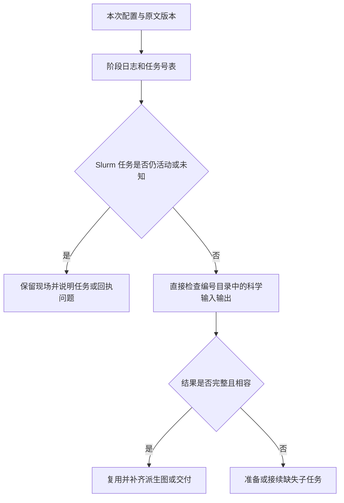

# 三个 CLI 开算前，到底在查什么

三个 CLI 共用一套检查。可以把它理解成：**先找到本次计算的说明书，再核对阶段日志、任务号和实际科学文件；能接着用的跳过，缺的补上，对不上的停下来说明原因。**

计算做哪些步骤，看[完整流程图](workflow.md)；本页专门说明“为什么还没开始算，就检查文件、打印 reuse 或报错”。

## 先解释这次报错：配置找错了位置

在 `epwflow/7.epw-fine/` 中执行：

```bash
epw_superconductivity -c "epwinput.toml" --stage superconductivity -s
```

命令会寻找 `7.epw-fine/epwinput.toml`，不会自动向上找。MgB₂ 当前算例实际的配置位于上一层 `epwflow/epwinput.toml`，其中已经有 `layout = "numbered"`。

**在 `7.epw-fine/` 中应写 `-c "../epwinput.toml"`。** 可以先只检查，再提交：

```bash
epw_superconductivity -c "../epwinput.toml" --stage superconductivity --check --json
epw_superconductivity -c "../epwinput.toml" --stage superconductivity -s
```

也可以从任意目录使用配置的绝对路径：

```bash
epw_superconductivity -c "/data/home/mayuan/code/dftflow/examples/MgB2/sugon-amd/run/epwflow/epwinput.toml" --stage superconductivity --check --json
```

当前入口先判断配置文件是否存在，决定是否进入编号工作区模式。**文件不存在时，也可能落到 `--stage 需要 layout='numbered' 的当前配置` 这条报错。** 所以，这条提示不只表示配置缺少 layout；本例的问题是相对路径找不到配置，尚未进入科学计算，也不是在说第 7 步结果不合格。

前面重复的 `input_conflict: input_conflict:` 来自错误类别与原始错误信息的重复输出，是同一条错误。

## 两种相对路径，各从哪里出发

| 路径写在哪里 | 从哪里开始找 | 当前算例的例子 |
| --- | --- | --- |
| 命令中的 `-c "epwinput.toml"` | 执行命令时所在的目录，即 `pwd` | 在 `7.epw-fine/` 中就会找该子目录里的配置 |
| TOML 中的 `work_dir = "."` | TOML 所在目录 | 指向整个 `epwflow/` 工作区，不随终端所在目录变化 |
| TOML 中的 `structure = "../POSCAR"` | TOML 所在目录 | 指向 `run/POSCAR` |
| TOML 中的 `kpath = "KPATH.in"` | TOML 所在目录 | 指向 `epwflow/KPATH.in` |

例如，从 `7.epw-fine/` 用 `-c "../epwinput.toml"` 找到根配置后，程序仍操作同一个根工作区，不会把第 7 步目录当成一套新计算。

`layout = "numbered"` 表示使用 `1.qe-scf/` 到 `8.epw-superconductivity/` 这套目录与续算规则。它是 TOML 顶层字段，应写在第一个 `[小节]` 之前；写在 `[qe]` 等小节下面就不是顶层字段。程序建立八份可读阶段日志；布局与声子模式记录在第 4 步日志，不再生成 `layout.json`。

## 从输入命令到开始计算

1. 读取本次 `-c` 指定的配置，检查原生参数、结构、赝势、程序位置和 MPI／pool 设置。
2. 比较最近一次配置版本。原文变了就在解析后的 `work_dir/epw-state/` 增加下一份 `0000-config.toml`、`0001-config.toml`；连续相同不重复保存，旧版不覆盖。
3. 读取对应阶段日志和计算目录中的 `.jobs`，向 Slurm 查询当前任务。活动或提交回执未知时拒绝覆盖和重复提交。
4. 从编号计算目录解析真实结果：SCF／NSCF XML、PH 响应势、Wannier 模型、粗／细矩阵和原生谱。科学完成还需通过对应解析器检查，Slurm 的 COMPLETED 本身不足以证明成功。
5. 已成功且相容的阶段和子任务跳过；缺失项生成或接续。明确重算覆盖本阶段的可替换内容，保留阶段目录本身和打开的 Slurm 日志。



## 八份阶段日志和任务号

`epw-state/` 保存八份中文纯文本日志；需要外部声子导入时保留 `imports/`。续算信息不再另外保存为请求、尝试、进度、后处理缓存或历史目录。

| 阶段日志 | 实际科学文件所在目录 | 主要检查 |
| --- | --- | --- |
| `1.qe-scf.log` | `1.qe-scf/` | 原生日志、总能、SCF 快照 XML |
| `2.qe-nscf.log` | `2.qe-nscf/` | 完整网格、带数、保存树及 FFT 接续 |
| `3.qe-electronic.log` | `3.qe-electronic/` | PW 能带、bands、DOS、投影各自结果 |
| `4.qe-phonon-模式.log` | 同名声子目录 | 逐 q 响应势、phsave、q2r／matdyn |
| `5.epw-wannier.log` | `5.epw-wannier/` | 拟合收敛、ukk 与模型文件 |
| `6.epw-coarse.log` | `6.epw-coarse/` | 粗矩阵、原生日志及比较子任务 |
| `7.epw-fine.log` | `7.epw-fine/` | 每个展宽的谱和矩阵分片 |
| `8.epw-superconductivity.log` | `8.epw-superconductivity/` | iso／aniso、各温度或 Tc 搜索 |

每个实际提交计算的阶段目录内使用同名 `.jobs`，例如 `1.qe-scf/1.qe-scf.jobs`。它只有子任务和 Slurm 作业号两列；详细进度、失败原因、科学检查及下一步放在阶段日志。

旧 `native-active.json` 中已经失效的输入路径不再是重算准备的前提。旧可见布局仅在一次性转换时读取固定旧状态，先核对旧任务终态，再检查现有科学结果，最后撤下旧状态；未知或活动任务保持明确阻断。配置原文版本、实际计算文件和外部导入资料分别保留。

旧 PW 能带输入中的 `CONTROL.pseudo_dir` 可以继续记录已撤下的目录。复用时完整比较原生输入，仅允许这一个目录字段的位置变化，并核对保存 XML 的元素／赝势文件映射、保存的 UPF 与当前配置赝势的 SHA-256。其他科学输入、SCF 电荷密度、几何、带数及实际 k 路径仍须通过检查；不改写历史 `eband.in` 或 XML，也不重建旧目录。

八日志转换后，若第 3 步显示“旧结果需要检查”，可在修复原因后重新执行 `epw_wannier --config "epwinput.toml" --migrate-state`。它检查当前作业、配置和依赖批次，仅在现有电子子任务全部核验通过后登记完成并清除旧报错；失败保留具体原因，不准备输入或执行科学程序。相关源码、受控回归及 SiP₂ 验收边界见 [0064 验收](../../specs/0064-epw-readable-state-logs/acceptance.md)。

## 检查不等于计算

`--status` 展示当前记录和科学检查结果，不补图或提交科学任务。配置驱动 CLI 仍会检查是否需要保存新的原文版本。复用科学结果后，公开推进命令可以继续补图、比较数据或发布结果包；派生交付失败不会把已通过检查的 PH 或拟合结果当成未完成。

结果包中的图参和科学来源清单服务于独立核验与重绘，不用来恢复任务调度。详见 [工作流](workflow.md)、[清理命令](epw_clear.md) 和 [0064 验收记录](../../specs/0064-epw-readable-state-logs/acceptance.md)。

第 6 步需要的比较声子后处理也放在声子目录的 `comparison/`，进度归入第 4 步日志。它使用 Γ onsite／Hermitian 修正，和默认 simple ASR 后处理分开存放，不能混用数值；仅修改电子拟合时可直接复用这些结果。
