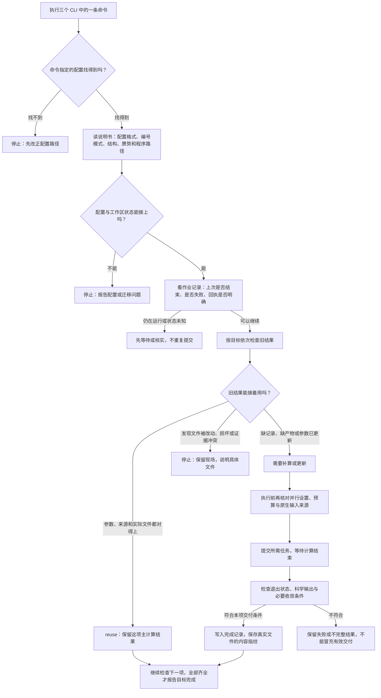

# 三个 CLI 开算前，到底在查什么

三个 CLI 共用一套检查。可以把它理解成：**先找到本次计算的说明书，再核对旧结果的清单和实物；能接着用的跳过，缺的补上，对不上的停下来说明原因。**

计算做哪些步骤，看[完整流程图](workflow.md)；本页专门说明“为什么还没开始算，就检查文件、打印 reuse 或报错”。

## 先解释这次报错：配置找错了位置

在 `epwflow/7.epw-fine/` 中执行：

```bash
epw_superconductivity -c "epwinput.toml" --stage superconductivity -s
```

命令会寻找 `7.epw-fine/epwinput.toml`，不会自动向上找。MgB₂ 当前算例实际的配置位于上一层 `epwflow/epwinput.toml`，其中已经有 `layout = "numbered"`。

**在 `7.epw-fine/` 中应写 `-c "../epwinput.toml"`。** 可以先只检查，再提交：

```bash
epw_superconductivity -c "../epwinput.toml" --stage superconductivity --check --json
epw_superconductivity -c "../epwinput.toml" --stage superconductivity -s
```

也可以从任意目录使用配置的绝对路径：

```bash
epw_superconductivity -c "/data/home/mayuan/code/dftflow/examples/MgB2/sugon-amd/run/epwflow/epwinput.toml" --stage superconductivity --check --json
```

当前入口先判断配置文件是否存在，决定是否进入编号工作区模式。**文件不存在时，也可能落到 `--stage 需要 layout='numbered' 的当前配置` 这条报错。** 所以，这条提示不只表示配置缺少 layout；本例的问题是相对路径找不到配置，尚未进入科学计算，也不是在说第 7 步结果不合格。

前面重复的 `input_conflict: input_conflict:` 来自错误类别与原始错误信息的重复输出，是同一条错误。

## 两种相对路径，各从哪里出发

| 路径写在哪里 | 从哪里开始找 | 当前算例的例子 |
| --- | --- | --- |
| 命令中的 `-c "epwinput.toml"` | 执行命令时所在的目录，即 `pwd` | 在 `7.epw-fine/` 中就会找该子目录里的配置 |
| TOML 中的 `work_dir = "."` | TOML 所在目录 | 指向整个 `epwflow/` 工作区，不随终端所在目录变化 |
| TOML 中的 `structure = "../POSCAR"` | TOML 所在目录 | 指向 `run/POSCAR` |
| TOML 中的 `kpath = "KPATH.in"` | TOML 所在目录 | 指向 `epwflow/KPATH.in` |

例如，从 `7.epw-fine/` 用 `-c "../epwinput.toml"` 找到根配置后，程序仍操作同一个根工作区，不会把第 7 步目录当成一套新计算。

`layout = "numbered"` 表示使用 `1.qe-scf/` 到 `8.epw-superconductivity/` 这套目录与续算规则。它是 TOML 顶层字段，应写在第一个 `[小节]` 之前；写在 `[qe]` 等小节下面就不是顶层字段。编号工作区新建时由程序建立 `epw-state/layout.json`，用户不需要手工创建这个文件。

## 从输入命令到开始计算：大白话流程图

下图把检查按用途分组，帮助理解；不表示每个函数调用的精确顺序。



`phonon` 目标的一次提交自动链在分配内继续推进；其他目标通常需要作业结束后重复同一公开命令来核验和推进。完整、相容的子任务会复用。预算不足或并行检查失败，也会在相应位置停止，不会绕过检查开始计算。

## 三个 CLI 分别检查到哪里

**区别主要是“这次要走到哪一步”，不是各自维护一套互不相干的数据。** 正常生成、提交和恢复按目标检查；只读 `--status` 会查看整个编号工作区的八阶段状态。

| 命令目标 | 正常推进时需要检查的阶段 |
| --- | --- |
| `epw_phonon --stage scf` | 1：SCF |
| `epw_phonon --stage nscf` | 1～2：SCF、NSCF |
| `epw_phonon --stage electronic` | 1～3：再加 QE 电子结果 |
| `epw_phonon --stage phonon` | 1～4：再加声子、save 与后处理 |
| `epw_wannier --stage wannier` | 1、2、3、5；不要求先完成第 4 步声子 |
| `epw_wannier --stage coarse` | 1～6，包括声子交付、Wannier 和比较任务 |
| `epw_superconductivity --stage fine` | 1～7 |
| `epw_superconductivity --stage superconductivity` | 1～8 |

省略 `--stage` 时，三个 CLI 的默认目标分别为 `phonon`、`coarse`、`superconductivity`。完整 TOML 的字段与路径仍统一校验；即使只做 SCF，也不能假定其他必填配置可以省略。

## 首先检查哪些输入和记录

| 文件或信息 | 大白话解释：为什么要看 |
| --- | --- |
| `-c` 指定的 TOML | 确认本次参数、工作区、目标、计算程序和资源设置；字段类型、数值范围及相容关系都要合法 |
| `POSCAR`、各元素赝势 | 确认材料结构与赝势可读；相关阶段还用文件内容识别是否换了科学输入 |
| `KPATH.in` | 配置指定时必须可读；未指定但与配置同目录存在时会自动采用，供路径和比较使用 |
| 配置中的 `pw.x`、`ph.x`、`epw.x`，以及显式配置的 Wannier 等可选程序 | 确认路径对应可读且有执行权限的文件；相关程序的内容也用于来源核对 |
| 环境脚本 | 配置了就要存在且可读；真正加载环境发生在作业执行时，登录端通过检查不保证计算节点环境已经正常 |
| `epw-state/layout.json`，已有时读取 | 确认编号目录的布局记录版本可识别；目录名称本身不算完成证明 |
| `epw-state/migration.json`，或旧 `.epwflow/` 的存在情况 | 避免把旧隐藏状态与当前可见状态混用；需要迁移时明确停止 |
| `epw-state/active.json`、`native-active.json` 与 `native-jobs/` | 记录本工作区提交了什么；结合 Slurm 判断是否仍活动、回执是否未知、上次是否失败 |
| 各阶段 `completion.json` 及其列出的文件 | 查旧结果的“完成清单”和“真实实物”，决定能否复用 |
| `[budget]` 指定的独立账本 | 提交、结算等操作核对累计用量和预留；重复命令不会重置预算 |

MPI 启动数要与 `resources.mpi` 相符，pool/image 与网格要相容；当前 EPW 路径要求单 image、每 pool 一个 MPI，且不能出现没有 k 点的空 pool。裸 `mpirun` 在作业加载环境后从 PATH 查找，配置读取不要求登录节点已加载它。

## 每个阶段的“完成清单”和“真实实物”

下面用 `prefix = "MgB2"` 举例。**不是只查表中几个文件；实际逐项核对完成记录所绑定的全部文件。** 表中列的是便于定位的关键例子。原生格式、点数和收敛等语义检查在接收科学输出或交给下游时进行，普通复用还会核对记录与实际文件的身份，不重新运行科学程序。

| 阶段 | 主要完成记录 | 关键实际文件举例与检查目的 |
| --- | --- | --- |
| 1 SCF | `1.qe-scf/completion.json` | `scf.out`、`out/MgB2.save/data-file-schema.xml`、电荷及保存数据；确认 SCF 结果属于当前结构和参数 |
| 2 NSCF | `2.qe-nscf/completion.json` | `nscf.out`、保存目录的 XML 与波函数；核对电子态及完整均匀 k 网格、带数 |
| 3 QE 电子 | `3.qe-electronic/completion.json`、`receipts/pw-bands.json`、`bands.json`、`dos.json` | `qe_eband/` 与 `qe_eledos/` 下的原生输入、输出及数据；细分任务均有证据才能完整复用 |
| 4 声子 | `4.qe-phonon-nosplit/completion.json`、`epw-state/qe-data/manifest.json` | 动力学矩阵、`save/` 中逐 q 的 dvscf、phsave，以及 q2r/matdyn 输出；确保声子结果、响应数据和映射完整。另两种模式使用对应编号目录 |
| 5 Wannier | `5.epw-wannier/completion.json` | `MgB2.wout/.chk/.ukk/.bvec/.mmn` 等；保存拟合与配套变换。下游还检查真实能窗、带空间及原生收敛 |
| 6 粗网格 | `6.epw-coarse/completion.json`、`epw-state/coarse/manifest.json` | `epwdata.fmt`、`crystal.fmt`、`out/MgB2.epmatwp` 和配套数据；核对粗矩阵格式、尺寸和来源。比较任务另有记录 |
| 7 细网格 | `7.epw-fine/completion.json`、`epw-state/interpolation/manifest.json` | `smearing-0001/MgB2.a2f`、`out/MgB2.ephmat/` 中的 `egnv/freq/ikmap/npool/ephmat*` 等；核对谱、本征值、频率、网格及矩阵分片，不只看有没有 α²F 图 |
| 8 超导 | `8.epw-superconductivity/completion.json` 及逐点／搜索记录、结果清单 | 各模式、温度、初值的原生输入输出及 Δ／Z；核对所用细网格来源、执行、收敛和数据有效性。Tc 与指定温度能隙按各自规则验收 |

细网格可能有多个 `smearing-*` 子目录，超导也可能包含多个温度与初值。上表不是可以手工凑齐的最小文件集合；不能只放几个同名文件或修改完成标记，就获得有效复用。

图片也有自己的完成记录：QE 的图位于相应 `plots/` 下并保存本目录 `completion.json`；第 5、6 步有独立 `post-completion.json`；原生子任务、插值尝试另有 `receipts/`、`epw-state/native-jobs/` 和 `native-attempts/` 等记录。**主计算复用了，仍可能需要补图、补比较数据或补完成登记。**

`native-plan.json` 是上次推进时写下的计划，不是 Slurm 实时状态；`epw-state/current-config.toml` 等由程序保存的副本也不代替本次 `-c` 指定的根配置。

## reuse 究竟通过了什么

`reuse: nscf` 可以读成：“当前请求下，这份 NSCF 的完成记录、参数、上游和记录绑定的实际产物都能对上，主计算继续用旧结果。”

程序主要核对三件事：

1. **计算条件对得上吗？** 本阶段及其依赖的科学参数、相关结构／赝势／程序内容没有变成另一份请求。改细网格参数通常只影响第 7、8 步；改 Wannier 条件影响第 5 步及其下游。资源调整不直接作为科学结果的失效依据，但仍需通过执行预检。
2. **接的是同一份上游吗？** 下游完成记录保存上游产物的身份；不能只因文件名相同，就把不同来源拼起来。
3. **清单上的实物还原样在吗？** 对绑定文件核对完整内容的 SHA-256 指纹、字节数与实际链接目标。不是只看存在、大小或修改时间，也不因上次查过就永久跳过读取。

| 检查结果 | 程序会怎样处理 |
| --- | --- |
| 记录、参数、上游和绑定文件都符合当前请求 | `reuse`，主计算结果保留 |
| 缺完成记录、必要产物缺失、科学参数或上游已经变化 | 状态通常为 `update`，生成／提交时安排更新；可能只补缺少的子任务 |
| 被检查的记录无法解析、已有绑定文件内容或链接目标发生冲突 | 报错停止，保留现场，不把损坏当正常完成 |
| 上次任务失败 | 先说明原因；修复后显式 `--resume -s`，仍要重验来源与成功部分 |

例如，删除已绑定的 `MgB2.chk` 会让第 5 步无法复用；把它替换成另一份同名文件则可能直接报来源冲突。`--resume` 表示恢复失败任务，不表示忽略冲突。

`reuse: phonon` 说明第 4 步可用；随后出现 `6.epw-coarse/comparison-native/phonon/` 是第 6 步的比较子任务。两者归属不同，详见[比较任务流程](workflow.md#第-6-步为什么还会出现-phonon-和-epw)。

## 用户平时用哪条命令看什么

以下命令假定终端位于 `7.epw-fine/`，所以配置用 `../epwinput.toml`。

```bash
pwd
ls -l "../epwinput.toml"
command -v epw_superconductivity
epw_superconductivity -c "../epwinput.toml" --stage superconductivity --check --json
epw_superconductivity -c "../epwinput.toml" --status --json
sacct -j 作业号 --format=JobID,State,ExitCode,Elapsed
```

| 操作／输出 | 能说明什么 |
| --- | --- |
| `--check` | 检查完整配置、输入和程序路径及目标相关并行设置；判断上游可用性时也可能读完成记录和产物。通过不代表所有阶段都已完成或计算节点环境正常 |
| `--status --json` | 只读查看整个工作区各阶段 `reuse/update` 和作业状态，不提交任务，也不替代下一次正式推进时的科学输出接收与登记 |
| 去掉 `-s` 的普通生成命令 | 准备当前就绪输入和脚本，可能写文件；它不是只读状态查询 |
| `submitted`、`job_id` | 任务已经提交，尚不能据此说计算完成 |
| Slurm `COMPLETED / 0:0` | 调度器确认作业正常结束；程序仍需核验实际科学输出及交付完整性 |
| 单项 `reuse` | 这一项可以继续用，不代表本目标所有后处理、图表和整个超导流程都已经完成 |
| 正式推进返回 `workflow_complete: true` | 本次目标所需的交付已经核验完成；例如 fine 完成仍不等于超导阶段完成 |

作业正常结束后，除声子自动链由作业内完成收尾外，其他目标通常需要再次执行同一公开命令 `-s` 来接收输出并继续。没有失败时无需为了“继续”额外加 `--resume`。

## 源码依据与导航

- [入口与目标选择](../../../epwflow/src/foundation/program.rs)、[配置和路径](../../../epwflow/src/foundation/config.rs)：配置定位、编号模式及两种路径基准。
- [阶段复用](../../../epwflow/src/foundation/stages.rs)、[文件指纹](../../../epwflow/src/foundation/store.rs)：参数、上游、完成记录与真实产物的比较。
- [原生任务记录](../../../epwflow/src/foundation/native_jobs.rs)、[工作区状态](../../../epwflow/src/foundation/workspace.rs)：活动任务、调度结果与续算。
- [科学产物绑定范围](../../../epwflow/src/foundation/workspace_science.rs)、[超导输入检查](../../../epwflow/src/superconductivity/source.rs)：各阶段实际证据与下游原生数据角色。
- [返回 EPW 总览](README.md)；[完整计算流程](workflow.md)；[原生超导行为](native-superconductivity.md)。
