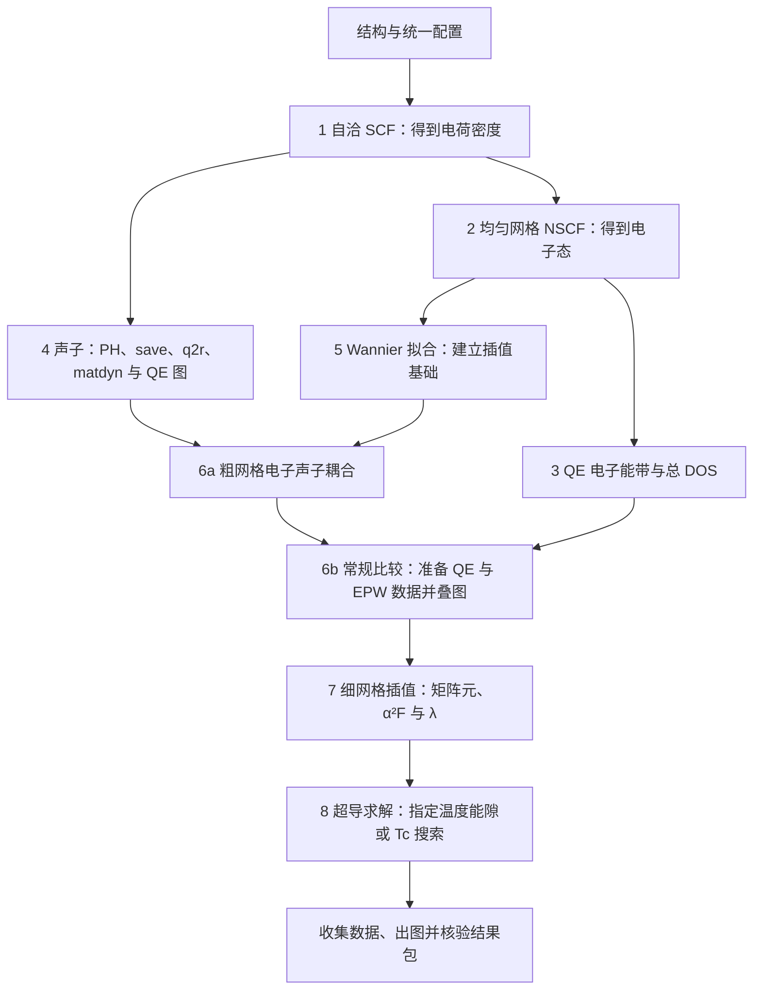
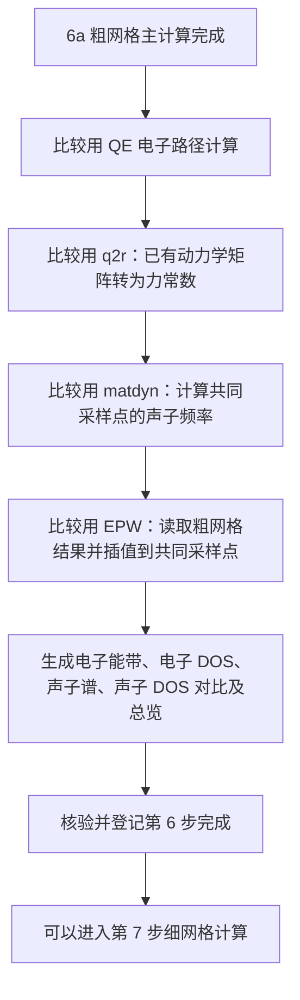

# EPW 完整流程与续算

`--stage fine` 表示“把工作区推进到细网格阶段”。程序先检查前置结果，复用完整且相容的部分，再补齐未完成部分。因此，命令里的目标和本次实际提交的任务可能不同。

## 完整流程图

图中的分叉表示数据来源。编号工作区仍按阶段顺序检查，不表示这些任务会同时提交。一个框代表完整阶段，可能包含多个原生程序和后处理任务。



第 6 步拆成 **6a 主计算**和 **6b 比较交付**，两者仍属于同一个 `coarse` 阶段。当前配置含 `KPATH.in`，常规比较会执行；没有配置路径的内部调用会跳过这条比较链。

| 用户选择的目标 | 命令 | 完整交付的核心内容 |
| --- | --- | --- |
| 第 1～4 步 | `epw_phonon --stage scf\|nscf\|electronic\|phonon` | 电荷、均匀电子态、QE 电子结果、声子与 EPW save |
| 第 5 步 | `epw_wannier --stage wannier` | Wannier 拟合及电子后处理 |
| 第 6 步 | `epw_wannier --stage coarse` | 粗网格耦合数据及常规比较图 |
| 第 7 步 | `epw_superconductivity --stage fine` | 细网格矩阵元、α²F 和 λ |
| 第 8 步 | `epw_superconductivity --stage superconductivity` | 按配置计算能隙或搜索 Tc，再整理结果包 |

表中每条命令均可加 `-c "epwinput.toml" -s`。竖线列出可选的单个阶段值。未指定 `--stage` 时，三个程序分别默认以第 4、6、8 步为目标；`fine` 不继续执行第 8 步。图表和其他后处理也会检查是否齐全，不能只凭主程序结束就切换下一阶段。

## 第 6 步为什么还会出现 phonon 和 EPW

`comparison-native` 是“生成比较数据时，实际运行科学程序的目录”。这些计算为 QE 实线和 EPW 虚线准备共同路径、共同采样网格上的数据。



对应目录如下：

```text
6.epw-coarse/
├── epw_coarse.in、epw.out      # 6a：粗网格主计算
├── comparison-native/
│   ├── electron/              # 比较用 QE 电子路径数据
│   ├── phonon/                # 比较用 q2r、matdyn
│   └── epw/                   # 读取粗网格数据，生成比较用插值结果
├── comparison/                # 整理后的共同坐标数据和差值
└── results/                   # 比较结果包及图
7.epw-fine/                    # 真正的细网格矩阵元和 α²F 计算
```

这里的 `phonon/` 复用第 4 步已有的动力学矩阵，**没有重新运行 `ph.x` 求声子响应**。第 4 步生成自身的 QE 声子结果；这里另按比较用的坐标集合和声学和规则准备 QE 对照，所以仍调用 q2r、matdyn。两处程序同名，输入与交付用途不同。

这里的 `epw/` 也执行插值，但用途是生成比较用电子能带和声子谱。输入为 `epwread=true`、`wannierize=false`、`band_plot=true`、`a2f=false`：读取已有粗网格数据，不重新拟合 Wannier，也不承担第 7 步细矩阵元和 α²F 的交付。

这套常规比较当前会生成图和最大差值；差值大小不阻断下游。原生执行、来源完整性、有限数及收敛等相应检查仍有效。

## 这次三个作业分别做了什么

以下是 2026-10-22 对 MgB₂ 算例的只读核对记录，用于解释这次输出，不代替后续实时状态。

| 作业 | 实际任务 | 在完整流程中的位置 |
| --- | --- | --- |
| `1329820` | `6.epw-coarse/epw_coarse.in` | 此前已经执行的 6a 粗网格主计算 |
| `1330436` | `comparison-native/phonon/q2r.in` | 6b：准备比较用力常数 |
| `1330742` | `comparison-native/phonon/matdyn.in` | 6b：生成比较用 QE 声子频率 |
| `1330804` | `comparison-native/epw/epw.in` | 6b：生成比较用 EPW 电子和声子插值数据 |

四个作业的 `sacct` 记录均为 `COMPLETED`、`0:0`。第三次比较任务已生成 `band.eig` 和 `phband.freq`，日志包含完整 EPW 结束计时。它在读取已有粗网格结果；**粗网格主计算更早已经执行，细网格计算尚未提交**。

现场 `native-plan.json` 保存的目标是 `fine`，前五步为 `validated`，`coarse` 与 `fine` 为 `pending`。其中任务状态仍是上次命令写入的 `running`；这不代表刚查询的 Slurm 作业仍在运行。该文件是推进记录，作业结束后需要公开命令核验产物，再更新阶段完成状态。

## 反复执行同一条命令，怎样向前推进

除声子自动链的专项入口外，逐任务提交路径每次 `-s` 的核心动作是：

1. 核验上一次作业及其实际产物，再检查目标所需的前置交付；打印 `reuse` 表示这一项已通过复用检查。
2. 找到第一个未完成任务，准备输入，最多提交一次新的原生程序调用，然后返回。
3. 作业结束后，再次执行同一命令，复用已完成任务并继续下一项；全部所需交付核验完毕才报告 `workflow_complete: true`。

因此，这次是在第 6 步内部依次补齐 `q2r → matdyn → EPW 比较`，不是每次从声子主计算重新开始。`reuse: phonon` 与后面提交 `comparison-native/phonon` 可以同时成立：前者指第 4 步，后者指第 6 步的比较子任务。

这三个比较作业结束后，继续执行原命令：

```bash
epw_superconductivity -c "epwinput.toml" --stage fine -s
```

程序会先核验比较数据并完成第 6 步登记；来源与数据检查均通过后，才提交第 7 步任务。以输出的实际 `directory` 和 `script` 判断本次任务，细网格任务应位于 `7.epw-fine/` 的相应展宽子目录。命令显示 `submitted` 只表示已提交，不表示该目标已经完成。

活动作业或终态未知时不重复提交；失败后先定位原因，再用原命令加 `--resume -s` 恢复。完整相容结果继续复用；改参或缺失产物可能需要补算，损坏或来源冲突会阻断。

## 与本地 0048 的关系

[0048 的需求](../../specs/0048-epw-phonon-stage-chain/spec.md)针对第 4 步：一次 `epw_phonon --stage phonon -s` 自动完成 `PH → save → q2r → 两次 matdyn → QE 声子图 → 最终登记`，从而减少下游目标代办第 4 步收尾的情况。

**第 4 步自动完成，不等于第 6 步的比较子任务消失。** 0048 明确不把 Wannier、coarse、fine、超导等其他目标改为自动整链。这次三项都在 `6.epw-coarse/comparison-native/`，属于该范围以外的比较任务，仍按逐任务规则推进。

当前工作树已有 0048 实施中的源码和文档改动；本页不据此认定现用安装已更新或自动链已验收。现场冻结脚本反映的是实际提交时的安装行为，源码、已安装程序和既有作业分别核对。

## 代码依据与导航

- [阶段依赖](../../../epwflow/src/foundation/stages.rs)：目标所需前置阶段与复用身份。
- [逐任务推进](../../../epwflow/src/foundation/native_workspace.rs)：复用、提交、核验、完成登记和后处理。
- [粗细网格调度](../../../epwflow/src/interpolation/scheduler.rs)：粗主计算后运行常规比较，完成后发布粗阶段交付，再供细网格读取。
- [比较任务](../../../epwflow/src/interpolation/automatic_comparison.rs)：电子路径、q2r、matdyn、EPW 重读及比较图生成。
- [公开入口](../../../epwflow/src/foundation/program.rs)：三个程序的默认目标和声子专项提交范围。
- [返回 EPW 总览](README.md)；[模块手册](../../../epwflow/README.md)。
