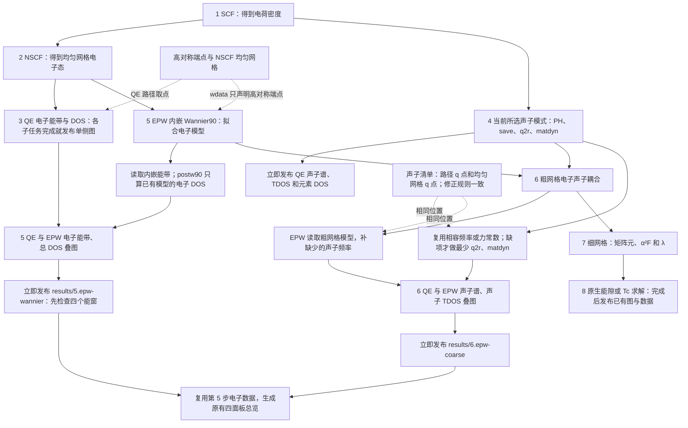
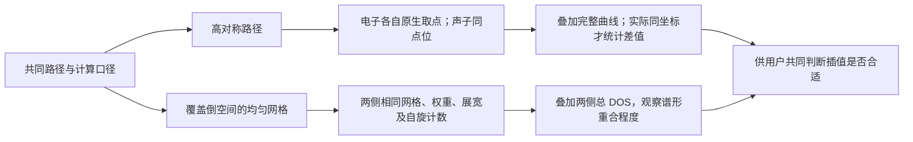

# EPW 完整流程与续算

电子比较在第 5 步完成，声子比较在第 6 步完成。每个阶段作业自己完成必要后处理、出图和发布；根目录的 `results/` 随阶段更新。源码行为、已安装程序和历史冻结脚本分别核对，旧脚本不会因源码更新自动变化。

## 完整流程图

实线表示数据来源。电子两侧沿相同高对称路径各自原生取点；声子虚线约束两侧使用同一份真实位置清单。它们不表示同时提交，也不把 q2r 的力常数与 Wannier 模型直接作数值对比。



第 5 步的依赖是电子 SCF／NSCF／QE 电子结果，不需要第 4 步声子或第 6 步粗网格产物。第 6 步仍包含粗网格主计算和声子比较交付，但不再新增电子参考 PW 计算。

| 用户目标 | 命令 | 作业内交付 |
| --- | --- | --- |
| 第 1～4 步 | `epw_phonon --stage scf\|nscf\|electronic\|phonon` | 电荷、电子态、QE 单侧图或当前模式的声子与 save |
| 第 5 步 | `epw_wannier --stage wannier` | 拟合、双能窗电子四张对比图、对应数据和窗口 |
| 第 6 步 | `epw_wannier --stage coarse` | 粗网格耦合、声子两张对比图与四面板总览 |
| 第 7 步 | `epw_superconductivity --stage fine` | 细矩阵元、α²F 和 λ；没有既有图时不额外新增绘图 |
| 第 8 步 | `epw_superconductivity --stage superconductivity` | 指定温度能隙或 Tc 搜索与既有结果图 |

各命令可加 `-c "epwinput.toml" -s`。默认目标分别为第 4、6、8 步；不会因完成一个目标而自动提交下一物理阶段。`electronic` 到 `fine` 及 Tc 目标使用一个阶段分配；指定温度的 gap 目标仍按 iso／aniso 分成独立原生多温度作业，最后完成的方法发布完整结果。

## 比较用的数据从哪里来

```text
计算工作区/
├── 3.qe-electronic/{qe_eband,qe_eledos}/
├── 4.qe-phonon-<当前模式>/
├── 5.epw-wannier/
│   ├── <prefix>_band.dat、<prefix>_band.kpt
│   └── comparison-native/            # 第 5 步电子数据、postw90 与来源
├── 6.epw-coarse/
│   ├── epw_coarse.in、epw.out
│   ├── comparison-native/
│   │   ├── force-constants/  # 必要时的比较力常数，独立检查点
│   │   ├── frequencies/      # 必要时的 matdyn，独立检查点
│   │   └── epw/                     # 读取已有模型补声子频率
│   └── comparison/                  # 整理表格与数值差
└── results/
    ├── index.json
    ├── 3.qe-electronic/{qe_eband,qe_eledos}/
    ├── 4.qe-phonon-<当前模式>/
    ├── 5.epw-wannier/
    ├── 6.epw-coarse/{comparison,figures}/
    └── 8.epw-superconductivity/
```

`results` 与编号目录同级。子目录保存图片、数值表、绘图参数、来源和 `stage-manifest.json`；根 `index.json` 是导航，不代替科学回执。原始科学文件仍留在阶段目录。第 7 步当前没有独立最终图片，不创建空结果包或新增科学任务。

电子 QE 路径值读取第 3 步。第 5 步 `wdata` 的 `kpoint_path` 直接读取现有 `KPATH.in` 的高对称端点对，每条真实边一行 `label x y z label x y z`，保留真实标签和断段，不加入逐点段、人工校准边或 NSCF 网格段。`bands_num_points` 使用用户原生设置，首段间隔数由它指定，后续由 Wannier90 按段长比例取整；密度不足以给短段至少一个间隔时，在计算前明确报错。

路径输入支持裸端点对和完整四行文件头“任意标题／正整数／Line-Mode／Reciprocal”；模式和坐标制关键字不区分大小写，空行及 `#` 注释不影响识别。只有完整文件头才会跳过，正文逐行严格校验并报告原始行号。无需改写已有路径文件或电子参考回执来适配自定义标题。

第 5 步明确恢复已退出的失败任务时覆盖现用失败内容，更新本阶段日志与 `.jobs`。旧任务输入已经移走不会成为重算的前置条件；活动或提交未知的作业仍先核对。恢复准备不代表拟合收敛，科学完成需重新检查原生结果。

QE 与 EPW 各自保留完整原生曲线，读取 `*_band.kpt` 和 `*_band.labelinfo.dat` 核验实际坐标及端点，以共同倒空间度量绘图；只在双方实际相同坐标和同一路径位置计算能量差，没有同点就不算，不显示共同点覆盖率。电子 DOS 保留 postw90 对已有模型的均匀网格求值，与 QE 使用同一网格、Gaussian 核宽、共同费米能及非磁标量每态两电子计数；网格不写入 `kpoint_path`，也不从路径推导 DOS。不重新拟合，不调用独立 `wannier90.x` 绘图。

第 6 步使用带哈希的第 5 步电子能带、DOS、统计及采样信息生成总览，不要求电子曲线与声子取点一致。电子和声子两侧均保留原生采样，不要求内部 k、q 点逐一重合；QE 声子使用第 4 步密度，EPW 声子使用第 6 步密度。只在已有共同坐标及路径位置统计差值，无共同点不补算、不重采样、不阻止出图。新旧图包重绘均取消紫色误差点、连线和相关图例；旧冻结输入、成功模型和科学回执不自动改写。

声子参考只读取当前配置选定的第 4 步模式，不能混用 nosplit、index、coords。现有第 4 步使用 simple ASR，而常规插值比较采用 Γ onsite 加 Hermitian 修正，再令 q2r／matdyn 不施加 ASR；这类力常数不能直接声称相容复用。必要后处理在执行前写入 `reuse-decision.json`，说明差异、已有来源和最少程序；成功力常数与频率分别复用，matdyn 失败不会使成功 q2r 重跑。不会为比较重做 SCF／PH。

不再建立 `epw-state/post/` 缓存。比较所需 PH 数据直接读取第 4 步实际目录；不同 ASR 或取点要求的必要 q2r／matdyn 在该声子目录的 `comparison/` 执行，检查点进入第 4 步日志。成功且相容的后处理可续接，电子模型变化时保留；不用持久缓存键或请求目录决定是否重算。

第 6 步 EPW 的 `band_plot` 原生接口同时要求 k 表和 q 表；这里只给一个必要占位 k 点，附带电子输出不再用于比较。电子对比始终读取第 5 步数据。声子比较只画 TDOS；元素声子 DOS 仅在第 4 步的 QE 单侧图出现。

## 路径与均匀网格为什么都要比



路径比较看沿线是否吻合；均匀网格 DOS 比较补充观察全倒空间分布是否吻合。路径点不参与 DOS 积分。两层比较共同服务人工判断，不增加自动评级、误差阈值门或粗网格收敛判断。电子图保留实际 `dis_win_min/max`、`dis_froz_min/max`，并在存在共同样本时说明最大差；能量配对不证明波函数身份相同。

2026-10-22 的历史 MgB₂ 快照中有 183 个路径点及 4×4×2＝32 个均匀网格点。它们是那次输入的数量，随路径和 NSCF 网格变化；该数量属于旧版共同点位采样，不能套用到现在的原生高对称路径。

## “登记”与失败恢复

科学完成、依赖批次、原文配置版本和各子任务续算均记录在所属阶段日志；`results` 的发布清单只核验交付图与数据。科学检查点先登记，完整阶段成功晚于发布，因此图失败可以保留计算结果，恢复时只补必要后处理、绘图或发布。

第 3／4 步分配脚本同步推进本阶段；第 5～8 步原生任务结束后，再次运行公开命令检查并收尾。活动或终态未知时禁止重提；失败修复后使用相同目标加 `--resume -s`。`--status --json` 查询实际状态，配置变化会触发原文备份；状态文字本身不能证明科学正确或图片已经交付。

例如：

```bash
epw_wannier -c "epwinput.toml" --stage wannier -s
# 原生任务结束后重复同一命令核验、推进，完成后查看 results/5.epw-wannier/
epw_superconductivity --plot --results "results"
epw_superconductivity --results-check --results "results" --json
```

完整 `results` 目录可移动后独立重绘，不要求原工作区、QE／EPW 或调度器可用。来源绝对路径保留作审计；包内哈希核验成功不等于原始来源仍可访问。旧工作区只从已登记且相容的旧比较来源整理派生结果；缺少可核验点位或模型来源时明确阻断该项交付，不为更名重做拟合。

## 历史作业解释

以下仅保留旧版工作区在 2026-10-22 的任务角色，不代表新版仍会逐项提交这些作业。

| 旧作业 | 旧任务 | 含义 |
| --- | --- | --- |
| `1329820` | `6.epw-coarse/epw_coarse.in` | 已有粗网格主计算 |
| `1330436` | `comparison-native/phonon/q2r.in` | 比较口径的力常数 |
| `1330742` | `comparison-native/phonon/matdyn.in` | 比较点位上的 QE 声子频率 |
| `1330804` | `comparison-native/epw/epw.in` | 旧版一起输出电子与声子插值值 |

当时的 `5.epw-wannier/native-post/submit-wannier-plot-*.sh` 属于旧版独立 W90 后处理，不是“第 6 步登记”本身。新版以第 5 步内嵌输出和 postw90 DOS 取代该路径；已经冻结的旧脚本与历史记录保留。

## 依据与导航

- [0063 高对称端点路径](../../specs/0063-epw-high-symmetry-path/acceptance.md)：原生取点、同坐标统计与 DOS 解耦。
- [0050 设计与验收](../../specs/0050-epw-stage-results/acceptance.md)：源码交付、隔离验证与真实科学验收边界。
- [阶段依赖](../../../epwflow/src/foundation/stages.rs)、[分配内推进](../../../epwflow/src/foundation/native_workspace.rs)、[电子采样](../../../epwflow/src/interpolation/electronic_sampling.rs)。
- [声子比较](../../../epwflow/src/interpolation/automatic_comparison.rs)、[阶段发布](../../../epwflow/src/foundation/stage_results.rs)、[派生图](../../../epwflow/src/foundation/workspace_science.rs)。
- [返回 EPW 总览](README.md)；[模块手册](../../../epwflow/README.md)。

## 电子图的两种范围

第 3 步：QE 能带两张、QE TDOS＋元素 PDOS 两张。第 5 步：QE／EPW 能带两张、TDOS 对比两张，共 8 张。普通文件名看费米能上下 5 eV，带 `-valence` 的文件看共同 QE 最低已计算占据态到费米能以上 5 eV。对应能带和 DOS 同窗，实际拟合窗另行标注。电子图全部画红色费米线，插值用蓝色，其他线和普通标签避开红蓝；PNG 为 3000×2100、至少 300 DPI。

第 3 步元素投影缺失时，只从已有 NSCF 波函数的隔离副本补必要 projwfc；已有相容投影和成功原生检查点复用。TDOS 与元素投影读取同次原生网格，保留残差；第 5 步不增加元素投影。详见 [当前电子图行为](README.md#电子双能窗元素-pdos-与保留色)和 [0055 验收](../../specs/0055-electronic-plot-windows-pdos/acceptance.md)。

DFTFlow 不再额外限制计算时长和存储空间，集群自身规则仍由 Slurm 管理。新生成的脚本及提交命令不添加时长限制；历史用量保留，作业身份和原有并发约束继续检查。旧配置字段的处理见 [EPW 总览](README.md)。
