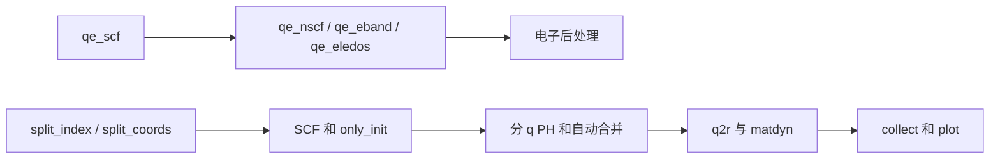

# qeflow：Quantum ESPRESSO 工作流

[返回项目总览](../README.md)

## 功能边界

输入生成、SCF/NSCF、电子结果整理、三种声子模式及后处理。Rust 家族命令为 qeflow，旧 qe_* 入口通过同一程序分派；内部 qe-ph-init-run、qe-phonon-chain-stage 是生成脚本使用的隐藏阶段，不作为手工起点。

## 命令与功能导航

| 功能 | 类型 | 用途 |
| --- | --- | --- |
| [三种声子模式与 dyn0](phonon-workflow.md) | 工作流说明 | Issue 0006 当前行为 |
| [qe_check](qe_check.md) | CLI | 检查单阶段状态 |
| [qe_eband](qe_eband.md) | CLI | 电子能带计算 |
| [qe_eledos](qe_eledos.md) | CLI | 电子态密度计算 |
| [qe_matdyn_phband](qe_matdyn_phband.md) | CLI | 力常数插值声子谱 |
| [qe_matdyn_phdos](qe_matdyn_phdos.md) | CLI | 力常数插值声子态密度 |
| [qe_merge](qe_merge.md) | CLI | 合并分 q 计算结果 |
| [qe_nscf](qe_nscf.md) | CLI | 电子非自洽计算 |
| [qe_ph_nosplit](qe_ph_nosplit.md) | CLI | 单步 PH 与仅生成真实 dyn0 |
| [qe_phonon_nosplit](qe_phonon_nosplit.md) | CLI | 不分 q 的声子流程入口 |
| [qe_phonon_split_coords](qe_phonon_split_coords.md) | CLI | 按坐标拆分声子全流程 |
| [qe_phonon_split_index](qe_phonon_split_index.md) | CLI | 按索引拆分声子全流程 |
| [qe_process_eband](qe_process_eband.md) | CLI | 整理投影能带 |
| [qe_process_eledos](qe_process_eledos.md) | CLI | 整理电子态密度 |
| [qe_process_phonon](qe_process_phonon.md) | CLI | 声子后处理、收集与绘图 |
| [qe_q2r](qe_q2r.md) | CLI | 动力学矩阵转力常数 |
| [qe_scf](qe_scf.md) | CLI | 电子自洽计算 |
| [qe_split_submit](qe_split_submit.md) | CLI | 分 q 子任务提交工具 |
| [qeflow scflow](scflow.md) | CLI | 通过 qeflow 进行超导后处理 |
| [qeflow status](status.md) | CLI | 刷新工作流状态 |

## 功能组成

```text
qeflow/
├── phonon-workflow.md
├── qe_check.md
├── qe_eband.md
├── qe_eledos.md
├── qe_matdyn_phband.md
├── qe_matdyn_phdos.md
├── qe_merge.md
├── qe_nscf.md
├── qe_ph_nosplit.md
├── qe_phonon_nosplit.md
├── qe_phonon_split_coords.md
├── qe_phonon_split_index.md
├── qe_process_eband.md
├── qe_process_eledos.md
├── qe_process_phonon.md
├── qe_q2r.md
├── qe_scf.md
├── qe_split_submit.md
├── scflow.md
└── status.md
```

## 使用关系

电子：SCF → NSCF/能带/DOS → 数据整理。声子：优先从 phonon-workflow.md 选择模式，再使用对应入口。status/check 读取结果并维护部分状态；qeflow scflow 复用独立超导库。



先读 [三种声子模式与 dyn0](phonon-workflow.md)。 查找生成 dyn0 的输入和输出，见 [初始化文件问答](phonon-workflow.md#dyn0-初始化文件问答)。通用配置使用 [qf-config](../../../crates/qf-config/src/lib.rs)；QE 电子与声子配置段不同，不能仅改命令名就假定参数完全沿用。

声子保存数据默认位于工作目录的 `tmp/`，显式 outdir 配置仍优先；详见 [配置与启动脚本](phonon-workflow.md#配置与启动脚本)。


## MPI 提交命令

新生成的科学调用使用普通命令，`mpirun` 从作业环境 PATH 查找，不写登录节点 MPI 绝对路径；原参数、科学程序路径和用户 header 保留。共享规则及历史边界见 [MPI 调用约束](../README.md#科学任务的-mpi-调用) 与 [0044](../../specs/0044-mpi-submit-command/spec.md)。
