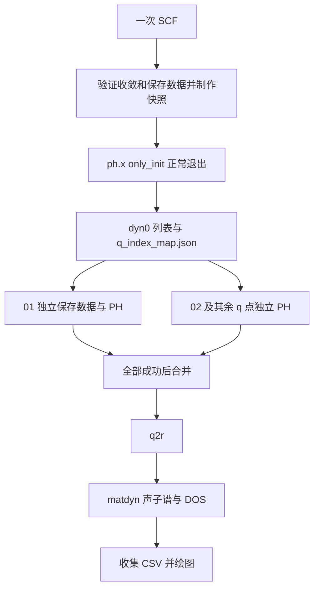

# 三种声子模式与 dyn0：Issue 0006 当前行为

[返回 qeflow 索引](README.md)

## 选择模式与直接命令

三种模式均有代码入口。index/coords 的完整自动依赖链已实现；nosplit 的算例使用显式作业脚本，直接聚合入口仍有限制。

| 模式 | 直接命令 | q 点处理 | 当前推荐执行方式 |
| --- | --- | --- | --- |
| nosplit | [qe_phonon_nosplit](qe_phonon_nosplit.md) | 一个 ph.x 任务处理整个网格 | 生成输入后提交已检查的显式作业脚本 |
| index | [qe_phonon_split_index](qe_phonon_split_index.md) | start_q=last_q=i | 命令加 -s，一次安排完整链 |
| coords | [qe_phonon_split_coords](qe_phonon_split_coords.md) | 每个任务输入一个 QE 笛卡尔 q 坐标 | 命令加 -s，一次安排完整链 |

准备好结构、配置和 KPATH 后，在相互独立的目录中选用一条：

```bash
# 索引拆分：一次提交全链路
qe_phonon_split_index -c input.toml -i POSCAR -s

# 坐标拆分：在另一个独立运行目录使用
qe_phonon_split_coords -c input.toml -i POSCAR -s

# 不分 q：准备输入，再提交算例生成的显式脚本
qe_phonon_nosplit -c input.toml -i POSCAR
sbatch nosplit_job.sh
```

以上是不同模式的替代用法，不是在同一个工作目录依次执行的步骤。nosplit_job.sh 来自算例准备脚本，不是任意目录调用 qe_phonon_nosplit 都会得到它。其内容按 SCF → PH → q2r → matdyn 声子谱 → matdyn DOS → collect → plot 执行。当前 nosplit 直接 -r 分支漏 q2r/matdyn，-s 分支存在重复后处理及相对路径问题，不能以算例成功证明这些分支已修复。

## 终端状态输出

三种入口仅准备时统一显示 `已准备声子流程输入与脚本：<工作目录>`。nosplit 提交成功显示 `已提交声子流程作业 <作业号>`；index/coords 显示 `已提交前置作业 <作业号>；后续计算及绘图将自动安排`。完成状态显示 `声子流程已完成：<工作目录>`。默认不列出逐项生成文件；错误和已有活动作业提示继续保留。计算日志仍在各工作目录中。

## index 与 coords 共用一份真实 QE 列表



初始化输入使用：

```fortran
ldisp = .true.
only_init = .true.
lqdir = .true.
```

这让 ph.x 完成初始化后正常结束，可能包含所需的电子态准备，但不会继续计算完整声子响应。程序等待本次运行正常退出，再检查日志和 dyn0；不会一看到文件就终止 MPI。

dyn0 首先声明网格，随后声明不可约 q 点数并列出坐标。DFTFlow 解析声明数量和对应坐标行，并检查完整性，不是简单统计文件行数。index 使用这份列表的 1 起始序号；coords 使用同序号的坐标。后者为 **QE 笛卡尔坐标，单位 2π/alat（QE 采用的晶格标度）**，不是倒格矢分数坐标。

q_index_map.json 同时保存序号、数字目录、晶体坐标和笛卡尔坐标；晶体坐标由 SCF XML 的倒格矢转换得到，非正交晶胞不能把两个坐标数组直接混用。各 q 任务显式关闭 only_init 等初始化专用开关，才开始实际 PH：

- index：ldisp=true，start_q=last_q=i。
- coords：ldisp=false，在输入末尾写对应 q 的笛卡尔坐标。

只有一套 SCF 网格；完整 outdir 的 SCF 快照复制到每个 q 的独立可写目录。新数字目录用 scf_reused.json 标记复用，不再各自执行 pw.x。

## dyn0 初始化文件问答

**问：你用来产生 dyn0 的那个声子计算的输入和输出文件是哪个？**

**答：输入是 `ph_init.in`，运行日志是 `ph_init.out`，生成的 q 点列表是 `prefix.dyn0`（MgB2 对应 `MgB2.dyn0`）。** 三者位于本次计算的 `[qe_phonon].work_dir`，与数字 q 点目录同级。

| 文件 | 用途 |
| --- | --- |
| `ph_init.in` | QE 初始化输入，含 `ldisp=.true.`、`only_init=.true.`、`lqdir=.true.` 及 q 网格设置 |
| `ph_init.out` | `ph.x` 初始化的标准输出和错误日志，用来检查报错及正常结束标志 `JOB DONE.` |
| `prefix.dyn0` | QE 生成的网格、不可约 q 点数量及坐标列表，供 index/coords 共用 |
| `ph_init_complete.json` | DFTFlow 验证日志和 dyn0 后写入的初始化成功记录，不代表全部声子计算完成 |

实际命令由配置中的 QE/MPI 启动方式组成，其输入输出重定向为：

```bash
# 在工作目录内由流程执行；MPI 启动参数取自配置
ph.x < ph_init.in > ph_init.out 2>&1
```

这里展示的是底层调用关系；若只需查看已经生成的列表，直接打开这些文件即可，无需重新运行。自动 split 与 `qe_ph_nosplit --dyn0` 使用同一套初始化实现与文件名。

分 q 后真正计算声子响应的输入/日志则在数字目录中，例如 `02/split_ph.in`、`02/split_ph.out`。它们与根工作目录的初始化文件用途不同；`MgB2.dyn0` 是结果数据文件，`ph_init.out` 才是初始化过程的文本日志。

文件名与执行关系依据 [prepare_input / run_init](../../../qeflow/src/phonon_init.rs)，分 q 文件依据 [链路脚本生成](../../../qeflow/src/phonon_chain.rs)。

## 只获取 dyn0 的两种工具

| 目的 | 命令 | 是否调用 QE | 是否需要已有 SCF |
| --- | --- | --- | --- |
| 获得实际 QE 的不可约列表 | qe_ph_nosplit --dyn0 | 是，仅初始化 | XML、电荷密度与波函数 |
| 独立运行保留的 Rust 网格算法 | qf-gen-dyn0 | 否 | SCF XML |

```bash
# 以下二选一：准备，或提交实际初始化
qe_ph_nosplit -c input.toml --dyn0
qe_ph_nosplit -c input.toml --dyn0 -s
```

该单步入口不会补跑 SCF，也不会启动分 q 或后处理；ph_init_complete.json 仅表示初始化完成。重新初始化会先归档旧 dyn0，避免失败后误用旧列表。自动 split 本身已包含此步骤，无需手工预跑。

独立 [qf-gen-dyn0](../tools/qf-gen-dyn0.md) 已从主 workspace 拆出，保留为单独工具；`qeflow gen-dyn0` 已移除。独立算法不保证所有磁性/对称性设置与 QE 完全等价，生产 split 不调用它。这是 0006 的后续补充，未把“保留独立工具”误写成“全库删除算法”。

## 目录由什么决定

`examples/MgB2/<machine>/run/{coords,index,nosplit}` 是 **算例 prepare.sh 主动创建的隔离层**。它还在每套配置中将 work_dir 指向该模式目录下的 qe_phonon。不是每次调用 qeflow 都必然生成同名 qe_phonon。

| 入口 | 未显式指定 work_dir 时的默认值 |
| --- | --- |
| qe_phonon_split_index | qe_phonon_split_index |
| qe_phonon_split_coords | qe_phonon_split_coords |
| qe_phonon_nosplit | qe_phonon_nosplit |
| qe_ph_nosplit（含 --dyn0） | qe_phonon |
| qe_process_phonon | 配置文件目录 |

`[qe_phonon].work_dir` 可覆盖默认值。新 split、--dyn0 初始化和聚合后处理按配置文件位置解析相对 work_dir；部分旧单步/合并入口仍依赖启动目录。跨目录执行时使用绝对配置与 work_dir，可减少歧义。不要在同一目录切换模式覆盖结果。

算例常见布局如下（这里的目录名不是程序的强制要求）：

```text
run/index/
├── input.toml
├── POSCAR
├── pp/
├── submit_phonon.sh
└── qe_phonon/
    ├── KPATH.in
    ├── scf.in / scf.out
    ├── scf_snapshot/
    ├── ph_init.in / ph_init.out
    ├── MgB2.dyn0
    ├── q_index_map.json
    ├── 01/、02/…
    ├── chain_jobs.json
    ├── chain_complete.json
    ├── phband/
    ├── phdos/
    └── phonon_combined.jpg
```

## 配置与启动脚本

默认 `[qe_phonon.scf].outdir` 为 `./tmp`，SCF 与 PH 初始化/分 q/合并共用该设置；显式设置其他目录会覆盖默认值。已有运行目录若显式使用 `./out`，继续按原配置读取，不自动搬迁或改写历史输入。 新算例准备脚本同样写入 `outdir="./tmp"`；历史 MgB2 的 `ph_init.in` 仍可能显示 `./out`，这是其原配置，不代表新默认值未生效。`outdir` 只控制 QE 保存树，不改变 ph_init.in/out 与 dyn0 位于工作目录根部的规则。

基本配置段关系如下；这只是字段示意，路径、执行环境和数值参数须按自己的体系补齐。

```toml
pp_dir = "/path/to/upf"
[qe]
executable_path = "mpirun -np 64 /path/to/qe/bin"
lattice_mode = "ibrav_angstrom"
[qe_phonon]
prefix = "MgB2"
work_dir = "/path/to/new-run/qe_phonon"
[qe_phonon.scf]
outdir = "./tmp"
kpoints = [4, 4, 2]
ecutwfc = 40.0
ecutrho = 320.0
occupations = "smearing"
smearing = "gauss"
degauss = 0.02
conv_thr = 1.0e-6
[qe_phonon.ph]
qpoints = [2, 2, 1]
tr2_ph = 1.0e-12
[qe_phonon.q2r]
zasr = "simple"
[qe_phonon.phband]
kpath_file = "KPATH.in"
kpath_points = 20
[qe_phonon.phdos]
qpoints = [2, 2, 2]
ndos = 100
[slurm]
header = """#!/bin/bash
#SBATCH --nodes=1
#SBATCH --ntasks=64
# 按本机填写 partition、时间限制和 MPI/QE 环境初始化
"""
```

分 q 入口无 -r/-s 时只生成准备文件与提交脚本；`bash submit_phonon.sh` 执行入口，由它提交前置作业。内部 pre/q/post 脚本才是 Slurm 作业脚本，不应把入口脚本再次当作计算作业提交。若不想使用任何包装，直接调用本页开头的 split 命令加 -s 即可。

-r 在已经分配的资源内顺序执行完整链，不会向 Slurm 申请资源。-s 通过 sbatch --parsable 获得作业号：q 依赖 pre 成功，post 依赖 pre 和全部 q 成功；无效依赖取消，不占计算资源轮询。前置阶段可能尚未运行，因此刚提交时看不到全部 q 作业是正常的。

## 续算、失败与完成判据

chain_inputs.json 绑定原配置、结构和模式；chain_jobs.json 保存阶段作业号。重复入口会查询已有作业，跳过仍活跃或已经完成的步骤；部分提交失败保留已成功提交的记录，并报告失败阶段。修复运行环境后可用原命令续算；修改计算输入应创建新目录。

某个 q 失败时不继续 post。合并检查日志、矩阵和 q 对应关系，按实际 outdir 查找 PH 数据；coords 的矩阵归一为 prefix.dyn<i>。只有后处理产物通过验证才写 chain_complete.json；作业成功入队或出现 dyn0 均不是完整计算完成。

最终产物包括：

| 位置 | 内容 |
| --- | --- |
| prefix.dyn0、prefix.dyn1… | q 网格与动力学矩阵 |
| phband/phonon_band.csv | 声子谱频率表 |
| phband/phonon_band_labels.csv | 高对称点标签 |
| phband/phonon_band.png | 独立声子谱图 |
| phdos/phonon_dos_atoms.csv | 原子分波 DOS |
| phdos/phonon_dos_elements.csv | 元素分波/总 DOS |
| phdos/phonon_dos.png | 独立 DOS 图 |
| phonon_combined.jpg | 左声子谱、右 DOS 联合图 |

## 实现与验收边界

实现见 [phonon_chain.rs](../../../qeflow/src/phonon_chain.rs)、[phonon_init.rs](../../../qeflow/src/phonon_init.rs)、[合并模块](../../../crates/qf-phonon/src/merge.rs)；覆盖见 [链路测试](../../../qeflow/tests/phonon_chain.rs)、[初始化测试](../../../qeflow/tests/phonon_init.rs)。

[0006 验收](../../specs/0006-qe-phonon-submit-chain/acceptance.md) 记录了 QE 7.4.1 下 MgB2 的 index、coords 与显式脚本 nosplit 对照，以及真实 only_init 验证；固定标准为对应频率差 ≤0.1 cm⁻¹、总 DOS 积分相对差 ≤10⁻³，同 MPI 配置对照通过。该记录不证明所有材料/机器或参数已收敛。其他机器的配置仍须单独补齐与验证。

本页只回写已查证的当前行为；需求背景见 [本地 Issue 草稿](../../specs/0006-qe-phonon-submit-chain/issue-draft.md)、[Spec](../../specs/0006-qe-phonon-submit-chain/spec.md)、[CLI 契约](../../specs/0006-qe-phonon-submit-chain/contracts/cli.md)。本次未重跑计算，也未修改这些需求文件。

## 声子谱路径与仅重绘

三模式共用同一绘图层：频率为纵轴，高对称点路径为横轴，完整保留虚频与路径跳段；联合图右侧 DOS 横轴与左侧共用频率纵轴。已有后处理结果可用 `qe_process_phonon -c input.toml -i POSCAR --plot` 更新 CSV 与图，重绘前保留旧图，不重新执行 QE。详见 [0009 路径与绘图验收](../../specs/0009-phonon-band-plot-rewrite/acceptance.md)。
