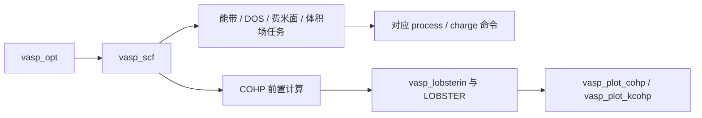

# vaspflow：VASP 输入与后处理

[返回项目总览](../README.md)

## 功能边界

准备 VASP/LOBSTER 任务并解析已有数据。Rust 家族命令 vaspflow；19 个 vasp_* 兼容入口，另有只能经家族调用的 vaspflow vasp-charge 输入生成。VASP、VASPKIT、LOBSTER 是外部程序，需按所用功能配置。

## 命令与功能导航

| 功能 | 类型 | 用途 |
| --- | --- | --- |
| [vasp_charge](vasp_charge.md) | CLI | 电荷密度平面平均 |
| [vasp_charge_diff](vasp_charge_diff.md) | CLI | 体积电荷差分 |
| [vasp_cohp_fatband](vasp_cohp_fatband.md) | CLI | k 分辨 COHP 前置输入 |
| [vasp_cohp_uniform](vasp_cohp_uniform.md) | CLI | 均匀网格 COHP 前置计算 |
| [vasp_eband](vasp_eband.md) | CLI | 电子能带任务输入 |
| [vasp_eledos](vasp_eledos.md) | CLI | 电子态密度任务输入 |
| [vasp_elf](vasp_elf.md) | CLI | 电子局域函数计算输入 |
| [vasp_fermi](vasp_fermi.md) | CLI | 费米面计算输入 |
| [vasp_idos_computed](vasp_idos_computed.md) | CLI | 能窗内积分 DOS |
| [vasp_lobsterin](vasp_lobsterin.md) | CLI | 准备 LOBSTER 分析 |
| [vasp_locpot](vasp_locpot.md) | CLI | 静电势计算输入 |
| [vasp_opt](vasp_opt.md) | CLI | 结构优化 |
| [vasp_plot_cohp](vasp_plot_cohp.md) | CLI | COHP 与积分成键分析 |
| [vasp_plot_kcohp](vasp_plot_kcohp.md) | CLI | 能带分辨 pCOHP |
| [vasp_process_eband](vasp_process_eband.md) | CLI | 投影能带表与图 |
| [vasp_process_eledos](vasp_process_eledos.md) | CLI | 投影 DOS 表与图 |
| [vasp_process_locpot](vasp_process_locpot.md) | CLI | 静电势平面平均 |
| [vasp_scf](vasp_scf.md) | CLI | 电子自洽输入与运行 |
| [vasp_scf_converge](vasp_scf_converge.md) | CLI | SCF converge 模板任务 |
| [vaspflow vasp-charge](vaspflow-vasp-charge.md) | CLI | 电荷密度计算输入 |

## 功能组成

```text
vaspflow/
├── vasp_charge.md
├── vasp_charge_diff.md
├── vasp_cohp_fatband.md
├── vasp_cohp_uniform.md
├── vasp_eband.md
├── vasp_eledos.md
├── vasp_elf.md
├── vasp_fermi.md
├── vasp_idos_computed.md
├── vasp_lobsterin.md
├── vasp_locpot.md
├── vasp_opt.md
├── vasp_plot_cohp.md
├── vasp_plot_kcohp.md
├── vasp_process_eband.md
├── vasp_process_eledos.md
├── vasp_process_locpot.md
├── vasp_scf.md
├── vasp_scf_converge.md
└── vaspflow-vasp-charge.md
```

## 使用关系

计算入口无 -r/-s 时生成输入，后处理入口则立即读取数据并输出。普通 setup 用 -p 指定结构，vasp_opt 用 -i；不能把参数在所有命令间直接互换。vasp_charge 独立名称对应后处理，计算输入用 vaspflow vasp-charge。



当前公共 setup 的能带/fatband KPOINTS 仍走均匀网格；使用前须检查并提供所需路径。各命令页列出其他实现边界。
