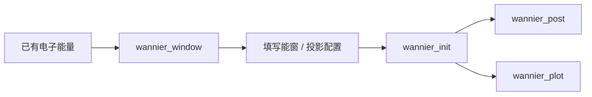

# wannierflow：Wannier90 接口与分析

[返回项目总览](../README.md)

## 功能边界

按用户要求将文档归入 wannierflow/；源码目录仍为 wannier90flow/，家族程序名仍为 wannier90。文档目录名不会创建 wannierflow 可执行文件。外部计算程序是 wannier90.x、pw2wannier90.x、postw90.x。

## 命令与功能导航

| 功能 | 类型 | 用途 |
| --- | --- | --- |
| [wannier_init](wannier_init.md) | CLI | 初始化 Wannier90 流程 |
| [wannier_plot](wannier_plot.md) | CLI | 对比 QE 与 Wannier 能带 |
| [wannier_post](wannier_post.md) | CLI | Wannier90 DOS 后处理 |
| [wannier_window](wannier_window.md) | CLI | 分析 Wannier 能量窗口 |

## 功能组成

```text
wannierflow/
├── wannier_init.md
├── wannier_plot.md
├── wannier_post.md
└── wannier_window.md
```

## 使用关系

window 从已有能量分析窗口，init 从配置准备 Wannier 流程，post 读取计算结果，plot 比较已有能带。init 之前需完成匹配的 QE 电子计算。


