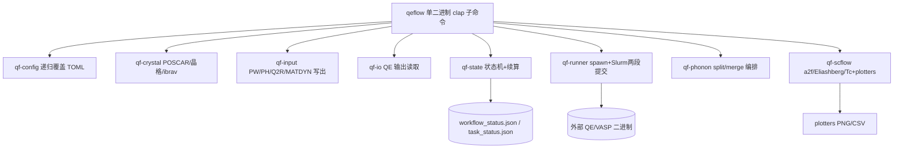

# Spec：qeflow Rust 全量重写（单一静态二进制）

## 1. 背景与目标

现有 `qeflow` 为 Python 实现，在性能很差的机器上受 Python 解释器启动、动态库导入与模块重载开销影响，启动与运行偏慢。本 Spec 将 `qeflow` 全量重写为 Rust，产出单一静态二进制，仅作为**编排层**：通过 `std::process::Command` spawn 外部 QE/VASP 等计算二进制，不内嵌任何 Fortran 计算逻辑。

新代码在 `qeflow-rust` 分支开发，以 cargo workspace 组织内部 crates。

## 2. 核心特性

- 单一静态二进制（`qeflow`，musl 静态链接 + strip），低内存占用、快速启动。
- CLI 用 `clap` 子命令映射现有 `qe_*` 命令（`qe-scf`/`qe-nscf`/`qe-eband`/`qe-eledos`/`qe-phonon*`/`scflow` 等）。
- 配置：`serde` + `toml` 复刻 `public/config_templates.py` 的递归深合并语义（`dict×dict` 递归，否则覆盖，`None` 不覆盖）。
- 状态存储：`serde_json` 读写 `workflow_status.json`/`task_status.json`，文件系统后端替代 MongoDB/Postgres。
- 外部调用：`std::process::Command` spawn QE/VASP。
- 数值/线性代数：`ndarray` + `ndarray-linalg`（`openblas-static` 静态链接）或 `nalgebra`，复刻 scipy 的 `simpson` 积分、Allen-Dynes / Eliashberg 求解。
- 绘图：`plotters`（替代 matplotlib，纯 Rust 无 Python 依赖）。
- 全量覆盖：输入生成、QE 文件解析、任务状态机、Slurm 编排、后处理（含 scflow 超导 Tc 计算与绘图）。

## 3. 非目标（范围外）

- 不修改 / 不内嵌外部 QE/VASP 源码。
- 不引入数据库或常驻 daemon。
- Darwin 仅作开发构建环境；发布目标为 Linux `x86_64-unknown-linux-musl` 静态二进制。
- 不改变现有 `input.toml` 的契约语义与 `workflow_status.json` 的状态机行为（仅用 Rust 复刻）。

## 4. 架构



## 5. 目录结构

```
qeflow-rust/                        # [NEW] cargo workspace 根
├── Cargo.toml                      # [NEW] workspace 成员与共享依赖
├── src/bin/qeflow.rs               # [NEW] 单一二进制入口
├── crates/
│   ├── qf-config/                  # [NEW] TOML 加载 + 递归深合并覆盖
│   ├── qf-crystal/                 # [NEW] POSCAR 解析、化学式、kmesh、ibrav
│   ├── qf-input/                   # [NEW] pw/ph/q2r/matdyn 输入 deck 写出
│   ├── qf-io/                      # [NEW] scf.out/ph.out/dyn*/dos/elph 读取
│   ├── qf-runner/                  # [NEW] Command spawn、Slurm 脚本、两段提交
│   ├── qf-state/                   # [NEW] 状态机、split_resume_step、三态判定
│   ├── qf-phonon/                  # [NEW] phonon split/merge 编排
│   ├── qf-scflow/                  # [NEW] a2f、Allen-Dynes、Eliashberg、Tc、plotters
│   └── qf-cli/                     # [NEW] clap 子命令定义与参数适配
```

## 6. 关键契约（详见 contracts/config-and-output.md）

- `executable_path` 语义为"启动命令+bin 目录"，运行时自动拼接 `pw.x/ph.x/q2r.x/matdyn.x`（复刻 `resolve_qe_command`）。
- `[qe]/[slurm]/[qe_phonon]` 配置块与递归覆盖保持兼容。
- 状态机保留三态（unstarted/finished/error）与 q 点 task 状态，续算基于 `split_resume_step` 的 1–11 阶段判定跳过 finished。
- Slurm 两段提交（pre: scf→dyn0→split 提交；post: merge→q2r→matdyn→plot）脚本生成逻辑 1:1 对齐现有 `qe_phonon_split_*` 行为。

## 7. 风险与对策

- **scflow 数学自实现**为最高风险：用垂直切片优先验证 `simpson` 积分、Allen-Dynes、Eliashberg 求解与 Tc 结果与原 Python `scflow` 数值一致。
- **绘图替代**：`plotters` 复刻 matplotlib 现有输出（PNG/CSV 形态、坐标轴、共享频率轴联合图）。
- **配置递归合并**：严格复刻 `_merge_dict_in_place` 的边界（`None` 不覆盖、`dict×dict` 递归）。
