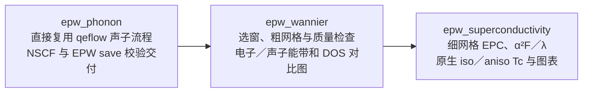

# 三个独立程序的整合契约

本次沿用本地 [0008 Issue](issue-draft.md) 与 [0010 Issue](../0010-epwflow-qe-data/issue-draft.md)，科学插值、求解和图表继续归属 0012／0013／0014，真实验证归属 0015；不另建线上 Issue。用户已明确要求实现和测试，入口形式已选择三个独立程序。本页是本次变更的集中契约，旧文档中的单一 epwflow 多子命令入口与三来源必需验收要求按本页更新；没有完成的科学证据继续保持未完成。

## 需求与验收

三个独立程序、共享 qeflow 声子执行与粗／细阶段分离已通过隔离进程验证。第二阶段独立参考及四类比较图的自动生成、真实原生 iso／aniso Tc 仍未完成；图示包含这些目标，不能作为完整科学验收证据。

| 需求 | 具体行为 | 成功标准与证据 |
| --- | --- | --- |
| FR-014：三个程序 | 仅交付 `epw_phonon`、`epw_wannier`、`epw_superconductivity` 三个 EPW 程序，各负责一个科学阶段；检查、生成、提交、状态、恢复、重绘在各程序的选项内完成 | SC-008：构建与安装入口清单只有这三个 EPW 程序，各自帮助和进程测试通过 |
| FR-015：直接复用 QE 声子流程 | 第一阶段调用 qeflow 的现有声子实现；首条主路径采用 nosplit，不要求三种 q 方式都完成才交付。qeflow 可选择保留并整理 EPW 所需原始数据，EPW 侧核对物理身份、模式和响应势 | SC-009：同一 qeflow 实现完成 SCF→PH→q2r→matdyn；EPW 交付具备 dyn0、逐 q 动力学矩阵、逐 q dvscf、phsave、身份和来源；缺项必须拒绝 |
| FR-016：粗网格与拟合交付 | 第二阶段选窗、Wannier／粗网格、独立质量检查和电子能带／总 DOS／声子谱／总 DOS 四类对比图；不运行细网格 EPC 或超导 | SC-010：第二阶段产物和调用记录证明四类图来自真实数据，并证明细网格未被提前执行；质量失败不能放行第三阶段 |
| FR-017：细网格与超导交付 | 第三阶段从已验证粗数据做细网格 EPC、α²F／λ、原生 iso／aniso 求解、Tc 和图表 | SC-011：逐文件来源、原生收敛、双初值、Tc 区间与结果包核验全部通过，不用经验 Tc 代替 |

## 已核实的 QE 现状

- qeflow 没有在声子完成后删除原 `prefix.save` 或 `_ph0`；已有分 q 流程还保存 `scf_snapshot`。因此主要缺口不是禁止删除。
- 现有 MgB₂ nosplit 输入为文本 `fildyn=MgB2.dyn`、`lqdir=false`。保留现有目录不能证明各 q 的响应势均完整；不能凭单个 `dvscf1` 发布 EPW 就绪。
- QE 源码 `PHonon/PH/phq_readin.f90` 按 `.xml` 后缀选择 XML 动力学矩阵；`q2r.f90` 支持同一 XML 命名。为 EPW 启用 XML 时，PH 和 q2r 输入必须一致。
- qeflow 的 nosplit 本地执行循环只执行 SCF／PH，漏掉已列出的 q2r／matdyn；复用前必须修复，提交路径也须避免重复后处理。
- 审查时 epwflow 独立维护 SCF／PH 调度。现已将 qeflow 实现提供为 Rust 库，第一阶段调用同一 nosplit 执行链；预算和分配由 EPW 基础层负责。旧三模式调度保留为内部历史回归路径，不作为新公开主路径。

## 实施分层与职责

1. qf-config 增加 `[qe_phonon].retain_epw_data`，默认 false，既有 qeflow 行为保持；首版仅 nosplit 允许该交付选项，未适配的分 q 路径明确拒绝。
2. qf-input 在启用该选项时生成 `ldisp=true`、`lqdir=true`、`fildvscf=dvscf`、完整 PH 与 XML 动力学矩阵；q2r 使用同一名称。保存数据不共享可写链接。
3. qf-phonon 拥有原生 PH 文件归档与角色／SHA-256 清单，不拥有 EPW 的科学通过结论。缺文件、空文件、重复 q、旧交付冲突或来源变化均拒绝；归档可复核后幂等复用。
4. qeflow 从二进制主体提取原实现为库，二进制仅调用同一入口；不复制第二份声子执行链。完整本地后处理与结束检查先通过进程回归，再接入 EPW。
5. 三个 EPW 程序共用配置、快照、预算、状态和执行器。外部输入继续使用 `inputepw.toml`，固定快照为 `input-init.toml`。移除旧公开 epwflow 入口时同步构建、安装、测试和文档，不留第四个 EPW 程序。
6. 拆分现有 interpolation 调度：粗网格清单不以细网格或谱存在为成功条件；第三阶段再创建独立细网格清单，避免修改已经绑定的第二阶段证据。

## 验证顺序与限制

先测试 qeflow 保留输入与真实进程后处理，覆盖关闭选项的兼容、缺响应势拒绝、来源不变和交付冲突；再验证三个实际可执行文件与阶段边界；最后在用户指定 `test_auto/MgB2/local_run/` 下建立编号目的目录进行实际数据只读导入、脚本生成和经预算约束的真实科学验收。历史目录只读，不覆盖结果。

原最大／RMS 声子门为当前已授权 50／20 cm⁻¹，电子标准、双初值及相对残差不放宽。已有共享 8 节点小时／100 GiB 预算不重置；此前未获允许的替代诊断作业不因本次整合自动执行。元素／轨道投影继续暂缓。三程序构建通过也不能代替真实 Tc 交付。

## 阶段清单迁移细则

第二阶段发布 `wannier/manifest.json`，只包含已核验的粗网格与质量证据，`fine` 为空、谱数组为空；它不能作为超导输入。第三阶段重验该清单和全部粗网格文件后执行细网格，另行发布 `interpolation/manifest.json` 并绑定前者的哈希，不改写第二阶段清单。工作流记录分别保留两项完成证据；恢复时验证既有证据，缺失或篡改立即停止。内部合并运行接口继续由这两个阶段顺序组合，供已有回归复用，不增加公开可执行文件。

## 三程序选项约定

三个入口均使用 `-c inputepw.toml`，默认固定输入并生成本阶段 Slurm 脚本，`-s` 提交，`-r` 在已登记分配中执行，`--resume -w <运行目录> -s/-r` 从固定快照恢复。`--check` 检查配置；结合 `-w` 检查本阶段数据。`--status -w` 查询共享状态，`--probe -s/-r` 探测环境，`--prepare-only` 只固定输入。`--import <清单>`、`--collect -w`、`--plot --results` 和 `--results-check --results` 复用现有校验／重绘能力，第一阶段禁止绘图和比较导出。账本通过 `--budget status|reserve|attach|reconcile` 操作。旧多层子命令不作为第四个程序保留。第二、三阶段在前置完成证据缺失时明确拒绝，不替代前一个独立程序启动计算。

## 一条命令生成总提交脚本

`epw_phonon --all -c inputepw.toml` 只生成三份阶段脚本和 `submit-all.sh`，不调用调度器。总脚本调用同一个 epw_phonon 的内部提交入口，按 `afterok` 串联三份脚本；各阶段在开始时仍重验自己的前置证据和共享预算，不增加第四个程序。提交前核验全部程序和脚本身份，逐次持久化提交中状态与严格回执；重复提交复用完整回执，部分／未知回执拒绝自动重提。依赖无效的后续作业使用 Slurm 的取消选项。总脚本不绕过尚缺的独立参考、外部程序兼容或科学质量门，全部提交成功不等于计算完成。

## 原预算账本兼容

现有本地验收账本使用 campaign／historical_jobs／attempts 格式。新入口须原位承接同一预算身份，逐项核对累计消费、终态及零预留，保留完整原记录和存储基线；未知或未结算记录拒绝转换。只读 status 不改账本；首次成功的预算写操作才保存兼容后的结构，不能创建空账本重置已用额度。
