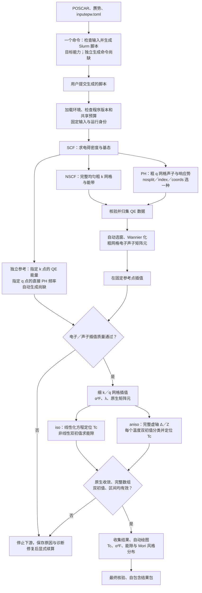

# 一条命令生成全流程脚本：流程草图与当前缺口

本图回应用户要求，描述目标流程，并明确区别已存在的编排与未完成的自动化。当前不新增命令、不提交计算、不把草图写成已实现能力。沿用 Epic 0007 与 F1～F5，线上 Issue 仍由用户管理。

## 从配置到结果的流程



SCF 是共同上游。图中的分支表达数据依赖，当前执行器仍在单个 Slurm 分配内顺序执行，并不表示已经支持分支并行。两种超导模式也顺序执行。完整流程中间的检查应由脚本调用同一个工作流执行器完成，不要求用户逐阶段输入命令。

独立质量参考来自直接 QE／PH 计算，不是拿当前插值结果给自己评分；已有参考只能在物理来源、坐标、能窗与身份核对后复用。当前质量来源还与共同 Fermi 严格绑定，新 SCF 不能无条件沿用旧参考。

## 每一步做什么

| 阶段 | 作用与主要输出 | 当前情况 |
| --- | --- | --- |
| 生成脚本 | 读取配置，生成可查看、随后可提交的脚本 | 缺独立“只生成”命令；现有 submit 生成内部脚本后立即提交 |
| 执行前检查 | 程序、MPI、资源、预算、输入快照 | 有部分检查及绑定；普通 check 不验证运行时版本、完整参考或实际账本格式 |
| QE 准备 | SCF、完整 NSCF、粗网格 PH，生成保存树及响应势清单 | 已有生产调度与共用 qeflow 基础能力；旧目录导入与恢复仍有边界 |
| 独立参考 | 固定 k／q 点直接计算，生成带身份的质量参考清单 | 当前要求外部先准备，未由主链自动生成 |
| Wannier 与粗网格 | 选窗、局域化、粗矩阵元、固定点插值 | 已接入生产调度；当前 EPW 5.9 缺选窗实现要求的关键字，不能直接跑通 |
| 质量门 | 电子最大／RMS、声子最大／RMS及来源核验 | 已有校验；PBE 必须使用 PBE 参考，不能套用 LDA 已通过结论 |
| 细网格 EPC | 原生细矩阵元、α²F 与 λ | 有生产函数及既有 LDA 阶段实测；新 PBE 参数仍待计算验收 |
| 两种超导 | iso 线性化 Tc 与非线性能隙；aniso 双初值非线性 Tc | 有执行与校验；真实非线性收敛问题尚未解决 |
| 交付 | 收集、PNG／SVG／PDF、自包含结果包和最终检查 | all 编排会调用原生交付；只有有效解才能形成正式能隙图 |

## 当前命令与目标体验

现有源码支持以下整体提交入口，不能将它描述为“一次提交已经真实验收通过”：

```bash
epwflow check -c inputepw.toml --json
epwflow submit -c inputepw.toml --until all
epwflow status -w epwflow --refresh --json
epwflow resume -w epwflow -s --until all
```

check、status、resume 是检查或恢复工具；整体执行成功时无需手工依次调用 qe-data、interpolation、superconductivity、collect 和 plot。当前 `prepare` 只固定输入，不生成独立可提交脚本。

用户期望的新增体验是：**一个命令仅生成脚本，查看后提交一次，脚本自动完成所有必需阶段及检查。** 命令名和参数尚未定稿，不把不存在的 generate 命令当作可用示例。生成与提交应复用同一执行器、账本和阶段校验，避免再维护一套串联命令的 Bash 科学实现。

复用既有声子数据属于后续可选入口，必须先验证并导入自身清单；本次配置只从结构开始，不能因旁边存在 qe_phonon_coords 就自动把它认作成功输入。

## 本次 PBE 本地配置

按用户选择，在 `examples/MgB2/sugon-amd/run/inputepw.toml` 写入配置。该目录按仓库规则忽略，配置作为本机运行输入留本地，不强制纳入 Git，也不复制或修改现有 POSCAR、赝势、input.toml 及声子目录。

- 采用现有 POSCAR 和两份 PBE USPP，SCF 4×4×2、PH 2×2×1、40／320 Ry、Gaussian 0.02 Ry；NSCF 4×4×2、16 带。
- PH 选 coords；新工作目录为 epwflow，保存基址为 epwflow-scratch，不复用已有声子目录。
- 细 k／q 网格采用 8×8×4／4×4×2，仅供小网格流程检查，尚未做物理收敛。
- 5 个 Wannier 函数，保留必需初始投影；不套用旧 LDA 的冻结上界或质量参考。
- 配置两种超导、μ*=0.05、截断 0.5 eV、1000 次、Broyden 0.7／8、1／10 meV 双初值、相对阈值 10⁻⁸。10～80 K 是待验证范围，80 K 不是已证实正常态。
- 声子门为最大 50／RMS 20 cm⁻¹；固定五个 q 参考点与六个 k 参考点，暂不填写不存在的 PBE reference_manifest。
- 资源设为 1 节点／24 MPI／2 小时；继续引用原 epic-0007 账本。配置文件不构成提交或新增预算授权。

目前至少有三项执行前阻断：原历史账本与生产账本字段不兼容；当前 EPW 二进制缺 dis_proj_min／dis_proj_max／dis_froz_proj；新 PBE 缺独立质量参考。最后还须解决真实非线性收敛。因此“配置检查通过”不能写成“可一键算出 Tc”。

## 源码依据与范围

- `epwflow/src/foundation/cli.rs`：公开命令；尚无独立脚本生成命令。
- `epwflow/src/foundation/workflow.rs`：submit 生成内部脚本并调用 sbatch；execute 顺序调度 QE、插值、超导和结果交付。
- `epwflow/src/qe_data/scheduler.rs`：SCF、NSCF、PH 和清单发布。
- `epwflow/src/interpolation/scheduler.rs`、`quality_binding.rs`：外部参考冻结、程序关键字检查、Wannier／粗细网格与质量门。
- `epwflow/src/superconductivity/engine.rs`、`parse.rs`：逐温度求解、搜索和严格拒绝未收敛。
- `epwflow/src/delivery/mod.rs`：最终收集、绘图和核验。

本轮只交付流程草图与本地配置，不实施新的脚本生成命令，不改科学实现，不新增作业。真实 Tc 与非线性失败的证据见[0015 源码诊断](../0015-epwflow-mgb2-real-validation/native-solver-source-audit.md)。

## 本轮验证

- 当前平台受测构建执行 `check -c examples/MgB2/sugon-amd/run/inputepw.toml --json` 返回 0，`operation_status=ok`、`workflow_status=configured`，运行时版本仍为 unverified。
- 同一构建只读读取原共享账本返回非零，明确拒绝旧字段 campaign；未迁移或清空账本。
- 只读检查 EPW 二进制确认三项 dis_proj 关键字均不存在，与调度器的兼容性阻断一致。
- 相对文档链接与空白检查通过。本轮没有修改 Rust 代码，因此不重复执行无关全套回归；没有启动科学程序或 Slurm。
