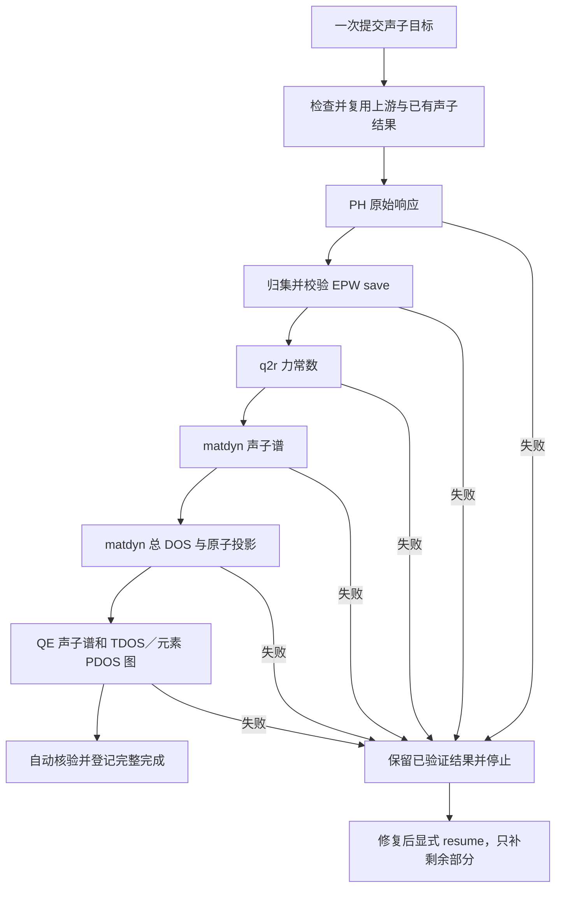

# 快速验证：声子自动完成

## 构建与回归

```bash
CARGO_PROFILE_TEST_DEBUG=0 bash scripts/build-native.sh test -p epwflow --test three_stage_execution phonon_chain -- --nocapture
```

隔离测试仅替代外部科学程序与调度器，真实运行公开 CLI、生成的 shell、源数据归集、严格校验和绘图；不提交真实作业。

## 正常使用

```bash
epw_phonon -c "epwinput.toml" --stage phonon -s
epw_phonon -c "epwinput.toml" --status --json
```

第一条只需执行一次；第二条可选，仅查看，不驱动计算。提交返回后自动完成以下流程：



已有结果按证据复用，图表在 4.qe-phonon-nosplit/plots；save 在本阶段 save/。Slurm 作业结束不单独证明科学数据有效，应检查父尝试结果及阶段交付。

## 恢复

```bash
epw_phonon -c "epwinput.toml" --stage phonon --resume -s
```

失败修复后一次恢复自动完成余项；不通过再次运行 coarse 收尾声子阶段。运行中或调度信息未知时不重提。
