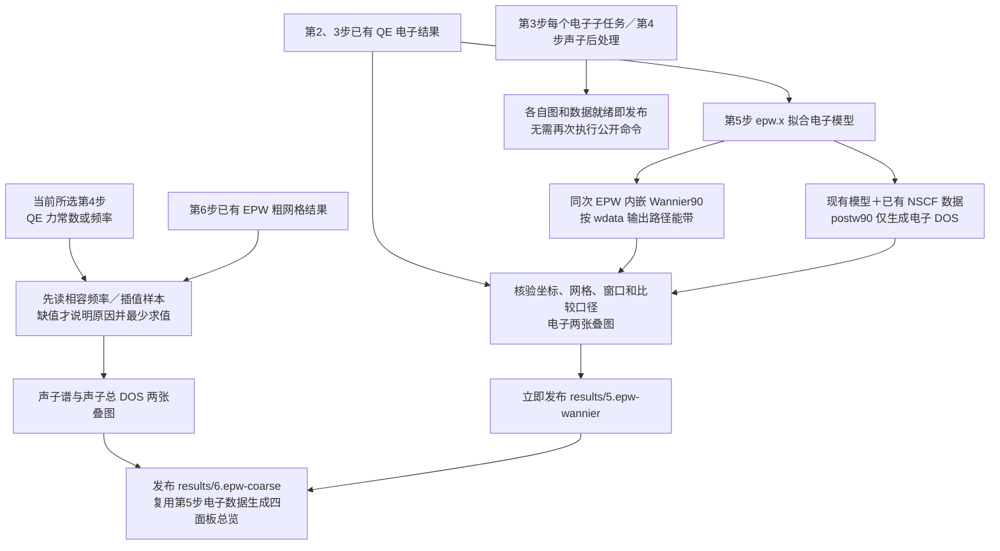

# 实施计划：电子对比前置与逐阶段发布

**日期**：2026-10-22。**基线**：[Spec](spec.md)。
**性质**：随本轮授权交付的待审阅设计；完整草案未确认，不启动本计划的业务实施。

## 总体方案与范围

复用 Rust／Bash 的现有阶段执行、QE 单侧图、比较表、图表和发布恢复能力。第 5 步拥有电子对比；第 6 步拥有声子对比和四面板总览；工作区根 results 是按阶段发布的派生交付位置。保留三个公开程序及现有配置名和阶段选项，不引入新入口、外部服务或生产 Python。

适用工程约束：科学来源严格核验；显示普通原生命令与 mpirun；不引入 shell 严格选项；并行任务不混淆科学身份；不改已有科学参数、预算、判据或历史文件。小规模内部函数拆分服务于已明确职责，避免另建调度框架或通用插件体系。

## 技术上下文

- **语言与版本**：Rust edition 2021、Bash；本轮只读核对的工具链为 rustc 1.99.0，未改工具链要求。
- **主要依赖**：复用 qeflow、qf-input／io／phonon／wannier、serde／serde_json、现有 plotters／svg2pdf 和交付模块，不计划新增依赖。
- **数据存储**：本地科学文件、现有 epw-state 回执和 JSON／CSV 派生包；没有新增数据库或外部服务。
- **测试体系**：Rust 集成测试及公开进程替身，既有 three_stage_execution／comparison_plots；实际程序验证另行记录。命令见快速验证。
- **目标平台**：现有 Linux HPC／Slurm 环境，使用实际 QE／EPW 及其内嵌 Wannier90，电子 DOS 使用相容 postw90。
- **性能目标**：不新增计时指标；以相容成功科学调用增量为零、图表随本阶段收尾完成为验收目标。工作量随实际路径／网格规模变化，不固定 183／32 点。
- **规模范围与约束**：单个计算工作区的分阶段交付；复用现有预算、防重和来源规则，不自动扩大真实计算范围或重置资源额度。

## 质量门

| 约束来源 | 强制要求 | 设计处理 | 当前状态 |
|---|---|---|---|
| 用户本次计划 | 本轮只做文档 | 仅新增本目录材料，不启动代码任务 | 文档范围满足，实施未开始 |
| Issue／Spec skills | 原话、完整正文确认、线上关联 | 原文逐字保存，正文待审阅，远程链接待用户登记 | 文档内容已检查，确认与远程门未通过 |
| AGENTS.md | 中文、范围隔离、验证后自动提交 | 只暂存本目录；既有修改保留；不推送 | 提交前检查并按要求提交 |
| Spec FR-005～007 | 复用与比较口径 | 来源身份及事前原因集中处理 | 设计已覆盖，实施待验收 |
| Spec FR-009～010 | 阶段内部发布与可恢复 | allocated 执行、科学检查点和最终交付分离 | 设计已覆盖，实施待验收 |
| 当前 Overview | 不把规划写成现状 | 本轮不改总览；T014 在实施验收后更新 | 文档边界满足 |

## Feature 文档结构

本目录包含 issue-draft.md、spec.md、plan.md、research.md、data-model.md、tasks.md、quickstart.md、acceptance.md、analysis.md、contracts/cli.md、checklists/requirements.md，以及 assets/Tue.6.Lafuente.pdf。源码结构与实际触点见下文“组件职责与变更位置”；需求到设计的逐项映射见 [一致性分析](analysis.md)。

## 拟交付目录

以下目录属于未来计算工作区设计；本轮只创建本 Spec 文档目录。

```text
计算工作区/
├── 1.qe-scf/
├── 2.qe-nscf/
├── 3.qe-electronic/
├── 4.qe-phonon-<模式>/
├── 5.epw-wannier/
│   └── comparison-native/electron/
├── 6.epw-coarse/
│   └── comparison-native/
│       ├── phonon/
│       └── epw/
├── 7.epw-fine/
├── 8.epw-superconductivity/
└── results/
    ├── index.json
    ├── 3.qe-electronic/
    ├── 4.qe-phonon-<模式>/
    ├── 5.epw-wannier/
    ├── 6.epw-coarse/
    ├── 7.epw-fine/
    └── 8.epw-superconductivity/
```

每个阶段包保留图片、对应表格、图参和来源。第 3 步能带与 DOS 分别有完整发布单元，尚未成功的单元不阻碍另一单元可见。没有已有最终图的阶段不创建空图或新增图任务。

## 目标流程

以下是待实现的流程，不表示当前全部实现：



第 5 步没有指向声子或粗网格的依赖边。两侧比较共同遵守真实 k／q 位置与单位等约束；均匀网格仅用于 DOS，路径仅用于能带／声子谱。第 5 步的发布不提交第 6 步。

## 组件职责与变更位置

| 组件／文件 | 变更设计 | 保留职责 |
|---|---|---|
| foundation/layout.rs | 新电子比较位置与根 results；旧布局识别集中在边界 | 阶段命名和工作区根解释 |
| interpolation/epw_config.rs | WannierOnly 加 wdata 路径、绘图参数、容量预检 | 现有窗口、收敛与 EPW 模式 |
| foundation/workspace_science.rs | 拆出电子比较准备／核验，复用 chk 等；取消外部 W90 绘图；postw90 仅 DOS | 原科学结果核验和检查点 |
| foundation/workspace_plot.rs | 真实坐标配对、窗口和未配对态说明；统一比较表输入 | 已有图形、窗口解析能力 |
| interpolation/automatic_comparison.rs | 第 6 步仅生成缺失声子样本，读取第 5 步电子表 | 第 6 步声子路线与四面板数据组合 |
| foundation/workspace_qe_plot.rs | 单侧图成功即形成可发布单元 | 第 4 步真实元素投影检查 |
| foundation/native_workspace.rs、workspace.rs、native_jobs.rs | 在既有分配内编排本阶段后处理与发布；各子任务及时收尾 | 父尝试、原生回执、预算与显式恢复 |
| delivery/{comparison,native,publication}.rs 及绘图模块 | 分阶段包、根导航、完整性校验、移动重绘、旧格式读取 | 已有发布恢复、来源保护和格式保留 |

上表均相对于 `epwflow/src/`。接口和数据字段见 [数据模型](data-model.md)、[契约](contracts/cli.md)。

## 数据准备与核验

电子参考路径来自第 3 步实际坐标与能量，均匀网格来自第 2 步的完整 NSCF。先比较模型、结构、源文件身份与口径，再决定直接读、转换或最少求值。第 3 步已有 DOS 不符合比较积分口径时，从已有 NSCF 能量重新累计比较表，保留原单侧图。

输入生成器应预先比较 QE 真实路径与内嵌 W90 的采样规则；输出读取器再核验实际坐标与分段。端点去重、断段和距离用同一倒格度量。不得仅用现有 xmax 比例缩放；不能用画线插值制造逐点参考。无法表达时明确缺项，不新增 PW，不自动改用户路径。原生路径验证必须先于声称 SC-001／003 完成。

第 4 步仅从当前配置所选模式读取。力常数、频率、ASR、质量、坐标和来源身份分别核验；已有结果相容就不再 q2r／matdyn。确有规则差异时隔离派生数据并事前说明，不能修改原始动力学矩阵或偷偷改变修正规则。

## 作业内执行与失败恢复

沿用 0048 的 allocated 执行模式与持久尝试，本阶段内只预留一次分配预算，不嵌套 sbatch。新增的是对应目标的后处理、核验、绘图和发布收尾，不把所有公开目标扩展成自动执行下一物理阶段。上游缺失仍按既有依赖语义处理，成功上游必须复用。

顺序为：核验已有科学检查点 → 必要科学任务 → 持久化科学证据 → 必要后处理 → 核验比较数据 → 出图 → 分阶段发布核验 → 记录该交付单元成功。可复用科学证据与最终交付成功的记录分开，不把图片缺失放进原科学身份，避免使成功计算失效。

第 3 步每个叶子任务完成后立即发布；另一叶子的失败不得撤回已发布结果。根索引仅指向核验完整的单元。作业内失败必须传播到父尝试并保留阶段、子任务与具体原因，不能捕获绘图错误后报告全部成功。显式恢复只处理未完成派生部分；活动／未知回执按既有规则阻止重复提交。

第 7／8 步仅把各自已有最终图及数据接入同样的发布钩子，不增加新科学求解或改变其任务数／初值语义。

## 旧工作区兼容

选择版本化只读适配＋派生导出：仅识别已知旧目录和清单版本，核验原身份后将电子比较职责导出到第 5 步、将可发布结果整理到根 results。保留旧科学文件、冻结脚本、回执、旧清单及历史报告原样，不移动或重写它们。

新请求使用新主契约；兼容代码集中在布局／读取边界，不为每个正常函数增加散落搜索。不能从三个声子目录逐个试读“哪个能用”。找不到可核验来源时报告具体缺项，不补抓当前文件哈希假装旧来源有效。

结果索引缺失但阶段包完整时可重建导航；阶段包内容变化则按来源及发布协议重新验证。不覆盖不同科学身份的旧包，保留现有发布恢复和格式保留规则。

## 实施阶段与验证

1. 明确布局、来源、复用判定、比较元数据和阶段包契约。
2. 实现电子主路径：EPW wdata、postw90 DOS、坐标／网格核验与第 5 步两图。
3. 实现声子复用与第 6 步职责拆分，组合四面板总览。
4. 接入本阶段作业内发布、第 3 步叶子即时发布及旧工作区兼容。
5. 完成有针对性的回归；在独立授权和预算允许时做最小原生验证，记录实际调用及文件哈希；实施验收后更新总览和手册。

测试优先覆盖 SC-001～008 的故障边界：无 PH、调用计数、真实坐标不一致、DOS 权重／自旋／展宽差异、损坏来源、当前声子模式隔离、发布中断和移动重绘。脚本／进程替身验证调度与防重复，原生 EPW 验证内嵌路径和 DOS 参数；两者不能互相替代。

## 文档与关闭门

[任务](tasks.md)列出技术拆解与依赖，[验收说明](acceptance.md)只按事实登记状态。代码验收后应用总览维护 skill 更新 EPW 总览及使用说明，未实现行为不得提前写入。线上链接、Issue 状态由用户管理；本地文档提交不代表线上 Issue 创建或关闭。
