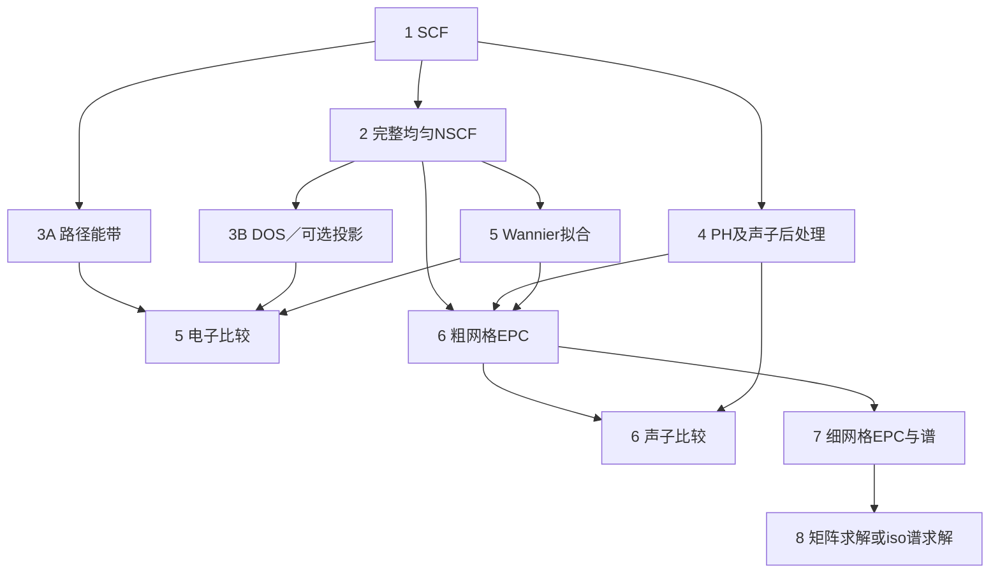

# 第 1～8 步前序数据接续表（供逐项审查）

日期：2026-11-17。依据：[已讨论的需求修订](reuse-files-spec.md)。

**本文是新要求下的目标设计草案，不是当前代码行为说明，也不表示已经实现或八步全部获得确认。** 用户要求先整体写出，以便逐项检查。第 1 步原则已确认；第 2 步此前仅提出、未确认，其余表格亦待审查。SCF 快照去留未定；本文统一写科学来源的 `out/` 路径作为拟议直接交接路径，不代表已经批准删除快照。

## 本轮原始需求记录

> 然后你按照我们刚刚讨论的理解，把1-8 步，每一步都需要复用前面的什么数据，最后我们整理写一个文档。 这样也能让我明确，每一步都需要复用什么数据。不要根据当前的代码来写，而是根据我们讨论的新要求写，然后我看看你写的对不对，我要注意检查，注意的是，每一步需要复用前面的什么数据，不光要用文字写清楚这个文件的作用，还要写上它对应的名字

> 1.qe-scf/out/MgB2.save/ 中的实际赝势文件，如 Mg.UPF、B.UPF 赝势文件，始终都用我指定的目录下面的赝势文件，修改这个文档

> 显式 startingwfc='file' 或原生重启时才按实际用途读取。 不需要设计这个功能，我没让你做的，你不需要做

> 既然需要复用，就把
>
> - **第 6 步构造粗网格模型：需要 `.ukk`、\`.mmn\`、\`.bvec\`，但不重新拟合 Wannier。**
>
> 相关内容复制进去把

> 为什么 6B 还需要电子的性质，不需要这个吧，第六步做粗网格插值只需要计算考虑声子计算的内容。
>
> 对应进行修改文档
>
> 执行

## 阅读约定

- 示例前缀为 `MgB2`，实际使用用户配置的 prefix，大小写保持一致。
- `4.qe-phonon-<模式>` 指用户选择的 index、coords 或 nosplit，不能把三种来源都当成必需依赖。
- `wfc*.dat`、`ephmatXX` 是文件族，不是字面文件名；执行时列出实际文件名，不能把星号和 XX 原样打印为真实路径。
- 电荷密度／波函数可为 `.dat` 或 `.hdf5` 等原生格式；按 QE 生成的实际名称读取。对这些原始数据不做存在性、尺寸、集合或哈希预检；实际复制及原生读取错误正常报告。
- 表格区分“前序计算输入”“前序绘图数据”“本阶段内部数据”。只取本任务需要的项，未选的子任务不引入依赖。
- 不建立 manifest、指纹或产物登记。必要原生格式／维度、日志成功和收敛检查保留；不为这些检查递归追查来源阶段。
- 当前目标完成只报告完成；真正读取、复制或链接前序计算数据才输出 reuse。查看成功日志不冒充科学输入。
- 各阶段赝势文件始终使用用户指定目录中的文件，不从前序 `.save/` 目录复制、链接或选取赝势，也不把它们列入阶段 reuse。原生 PAW 辅助数据与赝势文件分开说明。
- 新增计算输入如结构、用户指定目录中的赝势文件、k/q 网格、路径和温度等不是前序计算结果，不算阶段复用。

## 总表：每一步直接接谁

| 步骤 | 主计算直接接续 | 仅本步绘图／比较时额外接续 |
|---|---|---|
| 1 SCF | 无前序阶段 | 无 |
| 2 NSCF | 第 1 步自洽保存数据 | 无 |
| 3 QE 电子参考 | 路径能带取第 1 步；DOS／投影取第 2 步 | 不需其他阶段 |
| 4 QE 声子 | 第 1 步 SCF 电子数据，包括 PH 需要的 SCF 波函数 | 不需第 2、3 步 |
| 5 Wannier | 第 2 步均匀网格电子数据 | 电子叠图读取第 3 步曲线 |
| 6 粗网格 EPC | 第 2 步电子数据＋第 4 步声子响应＋第 5 步 Wannier 变换 | 声子叠图只取第 4 步声子频率和声子 DOS |
| 7 细网格 EPC | 第 6 步实空间重启数据 | 不刷新其他阶段 |
| 8 超导 | 第 7 步细网格矩阵，或所选各向同性路线的 α²F 谱 | 无需重查第 1～6 步 |

第 3 步不是第 5 步拟合的科学输入，第 5 步电子对比图才需要它。第 4 步不是第 5 步拟合的科学输入。第 6 步模型准备仍需第 2、4、5 步；第 7 步已有第 6 步实空间模型后，不再取它们的原始文件。

## 第 1 步：SCF

**前序复用：无。**

读取用户的 TOML、结构文件（如 POSCAR）和各元素赝势，生成 scf.in；运行 pw.x 输出 scf.out 与 out/MgB2.save/。

新 SCF 不需要旧波函数或旧电荷密度。首次执行不打印 reuse，已有结果完成则报告本阶段完成。

## 第 2 步：完整均匀网格 NSCF

**直接来源：第 1 步。作用是在已有自洽电荷密度形成的势场下，求新的完整 k 网格电子态。**

| 来源文件名／路径 | 文件作用 | 使用条件 |
|---|---|---|
| 1.qe-scf/out/MgB2.save/charge-density.dat（或原生替代格式） | 提供自洽电荷密度，供 pw.x 构造固定势场 | 必需数据；免预检 |
| 1.qe-scf/out/MgB2.save/data-file-schema.xml | QE 保存数据的晶格、原子、计算参数及电子信息 | 与保存数据配套 |
| 1.qe-scf/out/MgB2.save/ 中的 PAW 原生辅助数据 | 提供 PAW 保存信息 | 仅使用 PAW 且该版本需要时；具体名称按原生输出确定，不能编造固定名 |

复制到 2.qe-nscf/out/ 的独立保存目录，避免修改 SCF 原件。本步不复用 SCF 的 wfc*.dat，新的均匀 k 网格波函数由 NSCF 重新计算。不设计额外的波函数文件初始化或 NSCF 原生重启功能。

本步输出的新波函数、data-file-schema.xml 和本征能量供第 5、6 步使用。检查本步实际完整 k 点、顺序、权重和带数，不递归核验第 1 步的历史来源。

## 第 3 步：QE 电子参考

### 3A：沿高对称路径计算能带

| 来源文件名／路径 | 文件作用 |
|---|---|
| 1.qe-scf/out/MgB2.save/charge-density.dat（或原生替代格式） | 路径上的 pw.x 仍使用 SCF 固定势场 |
| 1.qe-scf/out/MgB2.save/data-file-schema.xml | QE 保存数据配套信息 |
| 同保存目录中必要的 PAW 原生辅助数据（不含赝势文件） | 配套原生数据，条件同第 2 步；赝势使用用户指定目录中的文件 |

路径点由当前任务的路径输入给出，不用第 2 步完整均匀网格的波函数代替路径计算。随后 bands.x 使用本子任务新生成的 XML 和电子数据整理曲线，这是第 3 步内部使用，不另打印“复用第 2 步”。

建议本阶段明确输出：qe_eband/MgB2.bands.dat（bands.x 的 filband），以及程序实际生成的对应曲线文件。**此名称是草案建议的统一输出名，并非声称原生默认或当前已采用。**

### 3B：总 DOS

| 来源文件名／路径 | 文件作用 |
|---|---|
| 2.qe-nscf/out/MgB2.save/data-file-schema.xml | dos.x 读取均匀网格本征能量、k 点、权重及占据信息并积分 DOS |

dos.x 不需要为总 DOS 重新读取全部原始波函数；其余保存元数据按 QE 实际接口需要接续，不能因此强制要求波函数。建议本阶段输出 qe_eledos/MgB2.dos（fildos 指定），供第 5 步比较。

### 3C：原子／轨道投影（仅选用时）

| 来源文件名／路径 | 文件作用 |
|---|---|
| 2.qe-nscf/out/MgB2.save/data-file-schema.xml | 本征能量、k 点、结构和电子态元数据 |
| 2.qe-nscf/out/MgB2.save/wfc*.dat（或原生替代位置／格式） | projwfc.x 用电子波函数做原子轨道投影；免核验 |
| 保存目录中必要的 PAW 原生辅助数据（不含赝势文件） | 提供原子投影相关的辅助信息；赝势使用用户指定目录中的文件 |

不把投影设为所有后续计算的前提。其输出名按 filpdos 前缀给出，例如 MgB2.pdos_tot、MgB2.pdos_atm#1(Mg)_wfc#1(s)；原子／轨道编号随体系变化，不能硬编码。

## 第 4 步：QE 声子与响应数据

**直接来源：第 1 步，而不是第 2 步。PH 需要与自洽计算配套的电子态。**

| 来源文件名／路径 | 文件作用 |
|---|---|
| 1.qe-scf/out/MgB2.save/data-file-schema.xml | SCF 晶格、原子、电子网格和计算参数 |
| 1.qe-scf/out/MgB2.save/charge-density.dat（或原生替代格式） | 自洽电荷密度；免核验 |
| 1.qe-scf/out/MgB2.save/wfc*.dat（或原生替代位置／格式） | ph.x 线性响应所需的 SCF 电子波函数；免核验 |
| 保存目录中必要的 PAW 原生辅助数据（不含赝势文件） | 线性响应计算所需配套信息；赝势使用用户指定目录中的文件 |

PH 的 index／coords／nosplit 只改变声子任务组织和归集，不改变以上科学来源。第 2 步改变网格、带数后的电子态不能随意替代这些 SCF 数据。

本阶段内部：ph.x 产生 MgB2.dyn0、MgB2.dyn1 等动力学矩阵及 dvscf、phsave；q2r.x 将动力学矩阵变为力常数文件（建议 flfrc='MgB2.fc'）；matdyn.x 读取力常数生成路径频率和 DOS。它们均属第 4 步内部，不是额外前序阶段依赖。

交付给第 6 步的声子保存文件名见第 6 步。建议绘图输出明确命名 MgB2.phband.freq（flfrq）与 MgB2.phdos（fldos）；这些是待审查的输出名，不从程序任意隐式默认推断。

## 第 5 步：Wannier 拟合与电子比较

### 5A：Wannier 化主计算

| 来源文件名／路径 | 文件作用 |
|---|---|
| 2.qe-nscf/out/MgB2.save/data-file-schema.xml | 完整均匀 k 网格、本征能量、带数和结构信息 |
| 2.qe-nscf/out/MgB2.save/wfc*.dat（或原生替代位置／格式） | 计算邻点重叠和投影，构造 Wannier 子空间；免核验 |
| 保存目录中实际需要的原生辅助文件（不含赝势文件） | EPW／Wannier 接口需要的原生配套数据；赝势使用用户指定目录中的文件 |
| 同保存树的 charge-density.dat（仅原生初始化确实读取时） | 配套势场／保存数据初始化，不能因为整树复制就声称拟合算法必读；免核验 |

本步设置 dis_win_*、dis_froz_*、初始投影和迭代参数。形成 MgB2.ukk（Bloch 到 Wannier 的变换）、MgB2.chk（Wannier 模型检查点）及所选接口的重叠／邻点数据。MgB2.wout 用于本步自己的拟合收敛和实际窗口说明。

第 4 步的 dyn、dvscf 不参与纯电子 Wannier 化。第 3 步电子曲线也不参与拟合。

### 5B：电子比较图

| 来源文件名／路径 | 文件作用 |
|---|---|
| 3.qe-electronic/qe_eband/MgB2.bands.dat 及其实际路径坐标 | QE 能带参考，用于与本步 Wannier 能带叠图；名称按第 3 步建议 |
| 3.qe-electronic/qe_eledos/MgB2.dos | QE 总 DOS 参考，用于电子 DOS 叠图 |

本步用自己的 MgB2.chk、MgB2.eig、MgB2.win 等已有模型数据执行选定 postw90 DOS 后处理；它们是本阶段内部输入，不再回查第 2 步做一次新的拟合。PDOS 只有明确绘制投影对比时才取，不作为总 DOS 比较的必需项。

缺第 3 步比较曲线就报告具体缺项，不补算第 3 步；已完成拟合保留，不能把缺图说成拟合失败。

## 第 6 步：粗网格电声耦合与声子比较

### 6A：构造实空间电声模型

| 来源文件名／路径 | 文件作用 |
|---|---|
| 2.qe-nscf/out/MgB2.save/data-file-schema.xml | 粗电子网格、本征能量与电子元数据 |
| 2.qe-nscf/out/MgB2.save/wfc*.dat（或原生替代位置／格式） | 计算 Bloch 表象电声矩阵所需电子波函数；免核验 |
| 第 2 步保存目录中原生程序需要的辅助数据和条件性电荷密度（不含赝势文件） | 提供配套原生初始化信息；密度免核验；赝势使用用户指定目录中的文件 |
| 5.epw-wannier/MgB2.ukk | 复用已确定的 Wannier 变换，不重新解纠缠、拟合 |
| 5.epw-wannier/MgB2.mmn | 相邻 k 点波函数的重叠矩阵，用于构造 Wannier 表象的位置矩阵及相关速度信息；EPW 6.0 构造粗网格模型时需要 |
| 5.epw-wannier/MgB2.bvec | 相邻 k 点的连接向量和有限差分权重，与 .mmn 配套；EPW 6.0 构造粗网格模型时需要 |
| 4.qe-phonon-<模式>/save/MgB2.dyn0.xml | q 网格及不可约 q 点信息；这是拟议统一归集命名 |
| 同 save/MgB2.dyn_qN.xml | 第 N 个归集 q 点的动力学矩阵，提供声子动力学信息 |
| 同 save/MgB2.dvscf_qN | 第 N 个 q 点的自洽响应势，供电声矩阵计算 |
| 同 save/MgB2.phsave/patterns.N.xml | 扰动模式／表示基底，用于解释响应势 |
| 同 save/MgB2.phsave/control_ph.xml | 声子任务与扰动元数据；按原生接口实际需要读取 |

N 为归集编号，原始 ph.x 的 dyn、dvscf 名称可能不同；第 4 步应归集为 EPW 所需命名，这些是科学文件整理，不是指纹清单。不能把这里的拟议名字写成所有 QE 版本唯一原生默认。

**第 6 步构造粗网格模型需要复用第 5 步的 MgB2.ukk、MgB2.mmn、MgB2.bvec，但不重新拟合 Wannier。** MgB2.chk 不因“它是 Wannier 模型”就自动成为粗 EPC 必需文件。

已核对本仓库 EPW 6.0 原生源码：`wannier.f90` 在 `epwread=.false.` 的模型构造分支调用 `vmebloch2wan`，不按 `vme` 选项跳过；`bloch2wannier.f90` 读取 `.bvec` 与 `.mmn`，缺失即报错。设置 `wannierize=.false.` 只是不重新拟合，不会免除这两个文件的读取。第 7 步重读已有实空间模型则不再需要 `.mmn`、`.bvec`。此结论仅限已核对的 EPW 6.0，不直接推广到其他版本。

不读取 .wout 重查拟合窗口，不强制取得 NSCF 费米能。主计算输出第 7 步所用的 epmatwp 和 fmt 数据。

### 6B：路径声子／声子 DOS 比较

| 来源文件名／路径 | 文件作用 |
|---|---|
| 第 4 步 MgB2.phband.freq | 已有 QE 高对称路径声子频率，对比 EPW 插值频率 |
| 第 4 步 MgB2.phdos | 已有 QE 声子总 DOS，对比 EPW 声子 DOS |

EPW 侧沿路径插值及声子 DOS 计算使用本阶段刚形成的实空间数据，所需文件同第 7 步重读路线；k/q 路径表为当前比较任务输入。QE 侧只读取第 4 步已有声子频率和声子 DOS，不重新运行 q2r／matdyn。第 6 步不读取第 5 步电子曲线，不生成电子与声子四面板总览。6A 的电子态和 Wannier 变换文件是电声耦合计算输入，与此处删除的电子曲线绘图依赖不同。

## 第 7 步：细网格插值、α²F 与 λ

**直接来源：第 6 步实空间数据。不是再从第 5 步拟合一次，也不重新读取第 1～4 步原始数据。**

| 来源文件名／路径 | 文件作用 | 使用条件 |
|---|---|---|
| 6.epw-coarse/out/MgB2.epmatwp | Wannier 实空间电声矩阵，用于傅里叶插值到细网格 | 重读模型路线 |
| 6.epw-coarse/MgB2.ukk | 已有 Bloch／Wannier 变换数据 | 原生重读路线使用 |
| 6.epw-coarse/epwdata.fmt | 实空间电子哈密顿量、动力学矩阵等重启数据 | 必需 |
| 6.epw-coarse/crystal.fmt | 晶格、原子等晶体信息 | 必需 |
| 6.epw-coarse/vmedata.fmt | 速度矩阵数据 | 按 vme 原生选项需要 |
| 6.epw-coarse/dmedata.fmt | 偶极矩阵数据 | 按 vme 原生选项需要；不一概要求与前者同时存在 |
| 6.epw-coarse/wigner.fmt | Wigner–Seitz 实空间网格／简并信息 | 按版本及原生选项需要 |

不把拟合窗口、完整 NSCF 本征值、上游指纹和 .wout 当作本步前置材料。能量筛选 fsthick、网格、展宽等本步参数仍需设置；费米能按 EPW 默认或用户显式选项处理。

新细网格计算不把旧 restart.fmt、selecq.fmt 当成必需；同一细网格任务中断续跑时，restart.fmt 保存已算进度，selecq.fmt 保存已选 q 点，按原生设置读取。这是第 7 步内部续跑，不是第 6 步交付。

多展宽时使用各自计算目录，前序来源相同，不能互相误取其他展宽的矩阵／谱。

## 第 8 步：超导能隙或 Tc

### 8A：读取细网格电声矩阵求解（iso／aniso）

| 第 7 步来源文件名 | 文件作用 |
|---|---|
| out/MgB2.ephmat/egnv | 细网格电子本征能量 |
| out/MgB2.ephmat/freq | 细网格声子频率 |
| out/MgB2.ephmat/ikmap | 电子 k 点映射 |
| out/MgB2.ephmat/ephmatXX | 细网格电声矩阵分片；必须使用实际原生分片名 |
| MgB2.dos | EPW 重启路线需要的费米面 DOS／相关原生数据；不是第 3 步 QE 的 DOS 曲线 |
| crystal.fmt | 晶体信息 |
| selecq.fmt | 被选择的 q 点及对应数据关系 |
| MgB2.a2f（可选） | 已算 α²F；有则按所选路线读取，没有时允许原生程序用细矩阵重新计算，不等于补算上游 |

以上路径相对第 7 步实际选定展宽目录，不是笼统读取整个 7.epw-fine。npool 等版本性辅助文件若原生实际需要，一并列出真实名称；不能凭包装层旧要求将其强制推广到所有版本。

第 8 步不需要第 6 步 epmatwp、Wannier 窗口、原始 QE 波函数或响应势。温度、muc、求解方法与收敛参数由本步输入提供；不同温度解的续接属于本阶段原生求解，不新增历史依赖检查。

### 8B：各向同性方程直接读取 α²F

| 第 7 步来源文件名 | 文件作用 |
|---|---|
| MgB2.a2f（或用户指定的实际谱文件） | 以 fila2f 指定的原生谱为输入，求各向同性方程或线性化 Tc |

这条路线不要求先读取 ephmatXX、egnv、freq、ikmap；不能用于替代各向异性矩阵求解。谱文件的列格式必须与原生 fila2f 接口相容，不把绘图 CSV 改名后冒充。选择此路线不表示新增求解能力，只说明其数据依赖；最终交付支持哪条路线待用户审查。

### 8C：各向异性 Eliashberg 方程读取细网格矩阵

**直接复用第 7 步已生成的细网格电声数据，不重新计算电声耦合矩阵元，也不能只用总 α²F 谱替代。** 各向异性求解需要保留不同电子态之间的耦合信息，总 α²F 已对这些信息做了平均。

下表采用已核对的 EPW 6.0 原生矩阵读取路线。路径相对第 7 步实际选定展宽的计算目录；例如该目录为 `7.epw-fine/smearing-0001/`，则在表中路径前加上此前缀。`out/` 对应原生 outdir，随实际输入变化。

| 第 7 步来源文件名／路径 | 文件作用 |
|---|---|
| out/MgB2.ephmat/ephmatXX | 细网格电声耦合矩阵元分片，提供不同电子态和声子模式之间的耦合；XX 必须替换为实际原生编号 |
| out/MgB2.ephmat/egnv | 细网格电子能量及相关网格、权重信息，供选取参与求解的电子态 |
| out/MgB2.ephmat/freq | 细网格声子频率，进入电声相互作用核 |
| out/MgB2.ephmat/ikmap | 电子 k 点映射，与电声矩阵的电子态索引配套 |
| out/MgB2.ephmat/npool | 写出矩阵时的 pool 数，EPW 6.0 用它定位并读取原矩阵分片；不表示求解必须沿用原 pool 数 |
| out/MgB2.dos | EPW 保存的费米能、费米面 DOS 等求解所需信息；不是第 3 步 QE 的 DOS 绘图文件 |
| crystal.fmt | 晶格、原子等晶体信息 |
| selecq.fmt | 已选择 q 点的信息，与保存的细网格电声数据对应 |
| MgB2.a2f（可选） | 已计算的总 α²F，供原生程序复用相关谱量；不是各向异性矩阵输入的替代品 |

读取以上数据后，温度、muc、求解迭代与收敛参数由第 8 步输入给出，选择各向异性求解（`laniso=.true.`）；不再读取第 1～6 步的波函数、声子响应势、Wannier 拟合窗口或粗网格 epmatwp。

本节只明确已有细网格矩阵路线的数据需求，不新增文件初始化或原生重启功能。各向异性求解的能隙、重整化函数等为第 8 步输出，不作为第 7 步必须交付的文件。

原生依据：`external/q-e/EPW/src/io/io_supercond.f90` 中 `read_frequencies`、`read_eigenvalues`、`read_kqmap`、`read_ephmat`、`read_dos`，以及 `supercond.f90` 的晶体信息读取。其他 EPW 版本需另核对，不能将版本相关辅助文件无条件推广。

## reuse 输出规则与例子

应从本次实际取用产生提示。下面示例假设速度路线确实读取 vmedata.fmt 与 wigner.fmt；若实际选择不读其中某文件，就不显示它。

```text
reuse: 6.epw-coarse
       6.epw-coarse/out/MgB2.epmatwp
       6.epw-coarse/MgB2.ukk
       6.epw-coarse/epwdata.fmt
       6.epw-coarse/crystal.fmt
       6.epw-coarse/vmedata.fmt
       6.epw-coarse/wigner.fmt
```

第 5 步主计算和比较都开展时，可分别出现第 2 步电子数据、第 3 步曲线；只拟合就不显示第 3 步。第 6 步粗 EPC 取第 2、4、5 步，声子比较额外读取第 4 步曲线；不应再显示第 1 步。第 8 步只显示所选第 7 步文件，不列全链。

## 数据流



箭头表示实际数据流，不表示自动补算、递归检查或自动提交上游。

## 请重点审查

1. 第 3 步路径能带从 SCF 接续，DOS／投影从均匀 NSCF 接续，是否符合期望？
2. 第 4 步必须取 SCF 的波函数；第 5、6 步取 NSCF 的波函数，不混用两份电子态。
3. 第 6 步三来源（2／4／5）与第 7 步单来源（6）的区别。
4. 第 8 步矩阵路线和 iso 谱路线是否都需保留为交付选项？本文不擅自决定。
5. 直接使用 SCF out 数据还是保留快照、建议的绘图输出名、PAW 辅助文件仍待确认，不能据此宣称精确文件契约全部定稿。

## 原生资料依据与文档边界

- Mori 讲义第 13 页的实空间重读、第 26 页矩阵重读与可选 α²F、第 41 页三类重启，区分 fresh fine、同阶段续跑和超导矩阵读取。
- Lafuente 讲义第 6～7、10、13 页区分 Wannier 化及既有模型插值，第 23～24 页说明路径电子自能的显式费米能用途。
- Marrazzo 讲义第 9 页说明拟合子空间的窗口用途。
- 三份文件位于 test_auto/MgB2/epwflow/，路径已在需求修订中保留。原生版本／选项差异在表中作为条件，不以当前 DFTFlow 的复制、登记或扫描行为决定应有依赖。

本轮仅写文档，没有代码、安装或科学运行变更；没有建立任何科学文件指纹记录。本文是技术需求草案，不作为已实现功能写入 Overview。
