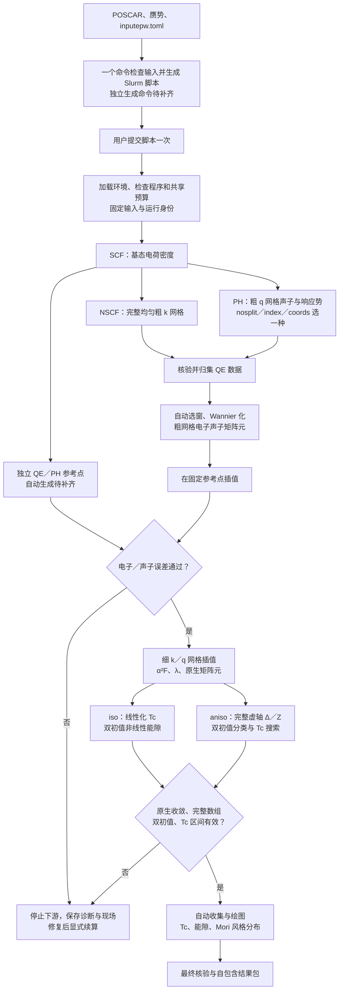

# epwflow

Rust 的 QE／EPW 超导工作流。当前功能以 [Overview](../docs/overview/epwflow/README.md) 为入口。**整体编排入口已有代码，完整真实自动链与两模式 Tc 尚未通过验收；独立“只生成脚本”命令尚未实现。**

## 完整流程图



图中的分支表示数据依赖。当前执行器在单个 Slurm 分配内顺序执行各阶段，两种超导模式也顺序执行。目标是把计算和检查都放进同一执行链，用户无需逐项调用科学程序。现有 submit 会生成内部脚本并立即提交；prepare 只固定输入，不能代替“生成脚本”。

## 使用前：配置、程序与目录

本机 PBE 配置位于 `examples/MgB2/sugon-amd/run/inputepw.toml`，使用同目录 POSCAR 与 pp 中的赝势，小网格仅供流程试跑。该目录按仓库规则忽略，配置不随 Git 分发。先在同一终端设置：

按最新文件名选择，epwflow 使用 `inputepw.toml`，同目录原有 `input.toml` 继续供 qeflow 使用。epwflow 通过 `-c/--config` 显式读取配置，支持其他文件名；两套配置字段不同，不能直接互换。运行固定快照仍为 `input-init.toml`。

```bash
cd "/data/home/mayuan/code/dftflow/examples/MgB2/sugon-amd/run"
EPWFLOW="${EPWFLOW_BIN:-epwflow}"
C="$PWD/inputepw.toml"
W="$PWD/epwflow"
LEDGER="/data/home/mayuan/code/dftflow/docs/local/epwflow-campaign.json"
"$EPWFLOW" --help
```

EPWFLOW_BIN 可指定已验证的可执行文件绝对路径；未指定时使用 PATH 中的 epwflow。源码、构建制品和默认安装分别核对，旧安装不一定支持本文命令。程序运行库按本机原生构建／安装说明加载；配置中的 environment_script 在作业内加载 QE／MPI 环境。

| 路径 | 含义 |
| --- | --- |
| C | 用户配置；相对输入路径按配置所在目录解析 |
| W | 配置的 work_dir；保存固定输入、工作流状态和阶段回执 |
| CALC | 实际计算根目录，通常为 W/calculations/尝试号；保存 QE、粗细网格与超导数据 |
| W/results | 整体 all 流程的最终结果包 |
| LEDGER | 共享预算账本，不能通过新建工作目录清零 |

提交记录建立后，从记录取得实际计算目录，不猜测尝试号：

```bash
CALC="$(python3 -c 'import json,sys; print(json.load(open(sys.argv[1]))["calculation_dir"])' "$W/.epwflow/workflow.json")"
```

prepare 后尚无 workflow.json；提交前不执行这条命令。恢复后重新读取 CALC。不要把原 qeflow 的 qe_phonon_coords 直接当作 CALC。

## 每个流程对应的命令

### 1. 配置、预算与输入准备

```bash
"$EPWFLOW" check -c "$C" --json
"$EPWFLOW" budget status --ledger "$LEDGER" --json
"$EPWFLOW" prepare -c "$C"
```

check 校验配置和文件，运行时版本仍为 unverified；它不证明程序兼容、独立参考或预算可用。budget status 只读核对账本。prepare 建立固定快照；submit 也会准备，因此单独 prepare 可省略。准备后不要修改 input-init.toml；物理输入改变应使用新的运行目录。

当前没有独立脚本生成命令，也没有 `interpolation run` 或 `superconductivity run`。以下 submit／resume -s 命令会实际调用 sbatch，不能当作预览命令执行。

### 2. SCF、NSCF、PH 与 QE 数据归集

从新运行开始，提交并停在 QE 数据阶段：

```bash
"$EPWFLOW" submit -c "$C" --until qe-data
"$EPWFLOW" status -w "$W" --refresh --json
```

执行器自动完成 SCF → 完整均匀 NSCF → PH 初始化／所选模式 → 响应势归集与验证，底层调用配置中的 pw.x、ph.x。PH 模式由 `[phonon].mode` 的 nosplit、index 或 coords 决定；没有各自独立的 epwflow SCF／NSCF／PH 执行命令。

作业达到终态后，读取前述 CALC，再检查阶段清单：

```bash
"$EPWFLOW" qe-data check -w "$CALC" --json
```

产物为 CALC/qe-data/manifest.json 及其登记的保存树、能带和响应势。Slurm COMPLETED 或 check 返回码 0 都不单独证明有效，须核对 workflow_status、validation_status、checks 和完成记录；no_data 表示没有数据。

### 3. 独立 QE／PH 质量参考

当前没有自动生成参考的公开命令。需事先准备固定 k 点的直接 QE 电子能量、固定 q 点的直接 PH 频率及来源清单，并在 `[interpolation.quality]` 填写 reference_manifest。点集、结构、赝势、能窗、共同 Fermi 和来源身份必须相容。

本机 PBE 示例没有对应参考，不能引用旧 LDA 参考；未准备好时先停止，不继续提交插值阶段。清单格式见 [0012 数据契约](../docs/specs/0012-epwflow-interpolation/contracts/interface.md)，自动生成参考仍是待补齐能力。

### 4. 选窗、Wannier 化、粗网格、质量门与细网格

QE 阶段成功，且参考与程序兼容性已解决后，扩展同一运行：

```bash
"$EPWFLOW" resume -w "$W" -s --until interpolation
"$EPWFLOW" status -w "$W" --refresh --json
```

该命令提交续算作业。内部依次冻结独立参考、选窗、调用 EPW 内置 Wannier90、计算粗矩阵元、在固定点插值并检查误差；通过后才计算细网格 EPC、α²F、λ 和原生矩阵元。细网格包含在 interpolation 阶段，没有单独公开执行命令。

完成或失败后，重新读取 CALC，可检查质量／插值数据：

```bash
"$EPWFLOW" interpolation check -w "$CALC" --json
```

存在 CALC/quality-reference.json 时，该命令优先检查独立质量；质量通过不代表细网格已完成，整体执行器还会核验细网格清单。产物包括 coarse、fine/smearing-NNNN、质量报告与 interpolation/manifest.json。

当前声子最大／RMS 门为 **50／20 cm⁻¹**；电子最大／RMS 门为 **0.05／0.02 eV**。历史旧门失败报告保留。只有原生输入输出和谱而无质量参考的目录最多报告 native_epc_only，不能据此放行超导。

### 5. iso／aniso 虚轴求解与 Tc 搜索

插值阶段完成后，继续超导：

```bash
"$EPWFLOW" resume -w "$W" -s --until superconductivity
"$EPWFLOW" status -w "$W" --refresh --json
```

`[superconductivity].mode="both"` 时自动执行两模式。iso 用原生线性化本征值定位 Tc，另用双初值非线性求能隙；aniso 逐温度执行完整虚轴求解，用独立双初值及逐态 Δ／Z 分类并定位区间。温度范围、次数、阈值和初值取自固定配置，没有 `--mode` 切换参数。

```bash
"$EPWFLOW" superconductivity check -w "$CALC" --json
```

产物为 superconductivity/manifest.json、tc.json、各模式 search.json、attempt-NNNN 输入日志和有效能隙。原生退出 0、打印自由能或写出能隙文件均不能代替收敛；未收敛小能隙不能判为正常态。partial／未定位结果保留原因，不填经验 Tc。阶段 check 的 workflow_complete=false 不是整体状态结论，最终状态须查看工作流记录和结果包。

### 6. 自动收集、绘图与最终检查

超导阶段完成后，扩展到最终交付：

```bash
"$EPWFLOW" resume -w "$W" -s --until all
"$EPWFLOW" status -w "$W" --refresh --json
"$EPWFLOW" results check --results "$W/results" --json
```

all 自动收集、绘图并验证结果。原生图包括 α²F／λ、能隙随温度、aniso 费米面加权分布、k 索引分布、Tc 区间与总览，默认 PNG／SVG／PDF。Mori 风格图使用有效双初值温度的最低正 Matsubara 逐态绝对能隙及物理权重，不用失败输出、经验 BCS 曲线或温度插值补齐。

已有核验后的阶段产物，仅需独立收集和重绘时可用：

```bash
"$EPWFLOW" collect -w "$CALC" --output "$W/results"
"$EPWFLOW" plot --results "$W/results" --formats png,svg,pdf
"$EPWFLOW" results check --results "$W/results" --json
```

这三条不运行 QE／EPW／Slurm，也不会把未完成的科学阶段变成完成。结果包可移动后独立重绘，本地完整性与原始来源可核验性分别报告。

## 一次提交与分阶段调试

以上逐阶段命令用于调试：每次确认当前边界成功后再扩展。前置阻断全部解决后，可从新运行直接提交全部阶段：

```bash
"$EPWFLOW" submit -c "$C" --until all
```

现有入口在一份有界分配中执行全部阶段和检查，无需再逐阶段提交。**“只生成脚本 → 用户自行 sbatch”的独立入口仍待实现；不要手工重提内部 .epwflow/slurm 脚本，否则会与已登记尝试和预算身份冲突。**

失败会阻断下游；修复后显式恢复：

```bash
"$EPWFLOW" status -w "$W" --refresh --json
"$EPWFLOW" resume -w "$W" -s --until all
```

resume 重验并复用已完成阶段，保留失败现场和次数，不自动放宽参数。活动或未知提交不重提。run 和 resume -r 仅用于已登记的 Slurm 分配，不能在登录节点绕过预算执行。

## 可选：QE／EPW 四类叠图

该支线另需直接 QE 能带／DOS、q2r／matdyn 声子色散／DOS及同源 EPW 数据，当前没有从主链完整自动生成这些参考的命令。已有真实来源后，替换来源清单路径并执行：

```bash
COMPARISON_SOURCES="/实际路径/comparison-sources.json"
R="$W/comparison-results"
"$EPWFLOW" interpolation export-comparison --source "$COMPARISON_SOURCES" --output "$CALC/interpolation/comparison"
"$EPWFLOW" collect -w "$CALC" --output "$R"
"$EPWFLOW" plot --results "$R" --formats png,svg,pdf
"$EPWFLOW" results check --results "$R" --json
```

来源格式见 [0012 数据契约](../docs/specs/0012-epwflow-interpolation/contracts/interface.md)，当前原生比较适配限定 MgB₂／QE 7.4.1／EPW 5.9。清单不会生成缺失的科学输出；若 CALC 也有超导清单，collect 同时收集原生超导结果。

默认输出电子能带、电子 DOS、声子色散、声子 DOS 四张图及 2×2 总览，QE 实线先画，EPW 虚线后画。comparison 来源的 wannier_wout={path,sha256} 指向实际 Wannier 日志，Outer／Inner 按共同 Fermi 展示并标记窗口边界，电子 DOS 在实际外窗重新累计；宽窗缺态仍属诊断，质量验证窗不变。声子最大采样误差用紫色突出，路径外 q 不冒充高对称点；诊断图成功不代替质量门。

元素／轨道电子 PDOS 和元素声子 DOS 按用户决定暂缓，缺可靠投影与本征矢时明确标缺失，不用总 DOS、键中心 Wannier 标签或模式序号代替。Wannier 必需初始投影仍保留。

## 当前阻断与真实结果

截至 2026-10-19，本机 PBE 配置通过配置检查，完整执行仍受以下问题阻断：

- 原共享历史账本与生产 BudgetLedger 字段不兼容，budget status 拒绝读取；不能新建账本清零绕过。
- 当前 EPW 5.9 二进制缺选窗实现要求的 dis_proj_min／dis_proj_max／dis_froz_proj，插值阶段会拒绝。
- 新 PBE 缺独立质量参考，不能套用旧 LDA 的通过结论。
- 真实非线性求解尚未收敛；提高迭代上限不保证得到所需分支。

既有 LDA 五点声子最大／RMS 为 49.448071／8.075133 cm⁻¹，按最新 50／20 门已通过；40³／20³ 细网格 λ_integral=0.6853853。iso 原生线性化 Tc 区间为 36.71～37.06 K，必需非线性能隙与 aniso Tc 尚未有效；这些不是新 PBE 的结果，也不代表两模式完整交付。

验证与源码诊断见 [0015 Tc 验收](../docs/specs/0015-epwflow-mgb2-real-validation/native-tc-validation.md)、[求解源码诊断](../docs/specs/0015-epwflow-mgb2-real-validation/native-solver-source-audit.md)、[MgB₂ 测试手册](../test_auto/MgB2/epwflow/README.md)。计算实体位于 test_auto/MgB2/local_run/001-epw-validation；独立脚本生成与自动参考的设计见 [0008 流程说明](../docs/specs/0008-epwflow-foundation/workflow-diagram.md)。
