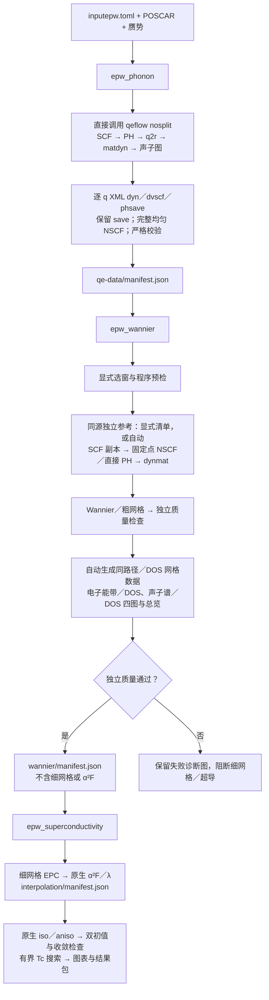

# epwflow

EPW 工作流仅构建三个独立程序：`epw_phonon`、`epw_wannier`、`epw_superconductivity`。配置默认名为 `inputepw.toml`，运行快照为 `input-init.toml`；同目录原有 `input.toml` 继续供 qeflow 使用。

三个入口、脚本生成和粗／细网格清单已接入。第一阶段直接调用 qeflow 共享执行库；第二阶段已接入独立参考、显式纯能量选窗、比较数据和四类图的自动生成。真实 PBE 全链与原生 iso／aniso Tc 的完整科学验收仍未完成。当前源码、构建产物和默认安装分别核对，旧安装不能直接使用下列新选项。当前功能见 [Overview](../docs/overview/epwflow/README.md)，整合契约见 [0008 三程序设计](../docs/specs/0008-epwflow-foundation/three-programs.md)。

## 三个阶段



第一阶段固定 KPATH、q2r／matdyn 程序身份及物理输入，直接调用同一 qeflow 库；SCF 结束后、PH 前保存不可变快照，完成后再执行 EPW 的完整均匀 NSCF。qeflow 原来就保留 scratch；新增的 `[qe_phonon].retain_epw_data=true` 让 nosplit 生成逐 q 响应势与 XML 动力学矩阵，并校验、归档到 `save/`，详见 [qeflow 手册](../qeflow/README.md#为-epw-保留声子数据)。第一条主路径采用 nosplit，不要求三种 q 方式都完成才交付。

## 生成脚本、检查和执行

先将受测构建目录加入当前终端 PATH，或用三个程序的绝对路径。以下命令在配置所在目录执行；`W` 取配置中的 `work_dir`。示例测试数据放在 `test_auto/MgB2/local_run/` 的编号目录，历史计算目录保留。

```bash
# 默认只固定输入并生成本阶段脚本，不提交、不执行科学程序、不预留预算。
epw_phonon -c inputepw.toml
epw_wannier -c inputepw.toml
epw_superconductivity -c inputepw.toml

# 一条命令生成三个阶段脚本和总提交脚本；仍不提交。
epw_phonon --all -c inputepw.toml
# 需要执行时运行生成的总脚本：
bash "$W/.epwflow/generated/submit-all.sh"

# 检查配置，不调用科学程序或 Slurm。
epw_phonon --check -c inputepw.toml --json

# 只准备固定快照。
epw_phonon --prepare-only -c inputepw.toml
```

生成脚本位于 `W/.epwflow/generated/`，依次为 `qe-data.sh`、`interpolation.sh`、`all.sh`。三个脚本分别对应三个程序；最后一个名字来自内部完成边界，执行第三阶段时仍要求前两阶段已有有效完成证据。手工 `sbatch` 这些生成脚本时，计算节点入口先验证脚本和程序身份、前置证据及分配，再登记共享预算。

```bash
# 直接提交第一阶段；成功回执只说明已提交。
epw_phonon -c inputepw.toml -s

# 查询和结算；W 必须替换为实际 work_dir。
epw_phonon --status -w "$W" --refresh --json

# 第一阶段完成后再提交第二阶段，第二阶段完成后再提交第三阶段。
epw_wannier -c inputepw.toml -s
epw_superconductivity -c inputepw.toml -s

# 按失败阶段显式恢复，使用固定快照；每次只选择实际失败的程序。
epw_phonon --resume -w "$W" -s
epw_wannier --resume -w "$W" -s
epw_superconductivity --resume -w "$W" -s

# 在已经登记的 Slurm 分配内执行；登录节点不能直接执行。
epw_phonon -c inputepw.toml -r
```

总提交脚本用 Slurm `afterok` 串联三个作业，并设置依赖无效时取消后续作业。逐次提交回执保存在 `chain-submission.json`；完整重复调用返回既有回执，部分或未知提交禁止自动重提。每个计算节点入口仍分别登记并检查原共享预算；总提交成功不代表科学完成，独立参考、选窗或科学检查失败会明确阻断。失败后按对应阶段显式恢复；旧的依赖作业不会自动改绑新作业号。

执行节点须能调用 `scontrol` 和 `sacct`：前者核对当前作业的唯一运行分配及固定节点数，后者负责终态结算。记账暂缺时保留预算预留；不通过环境变量补造资源或用量。

内部 `.epwflow/slurm/` 脚本属于已提交的尝试，不能手工重提。科学输出保存在 `W/calculations/<尝试号>/`；恢复沿用原科学目录，已通过阶段重新验哈希，失败现场保留。共享声子链后处理失败时可复用已核验的 SCF／PH，固定请求或受控脚本被篡改则拒绝恢复。粗／细阶段通过 native-attempts 检查点重验完整原生输出；显式恢复时将失败尝试归档到 history，按原参数重试，成功展宽直接复用。质量失败只复核原结果，未知目录、变化来源或篡改证据拒绝恢复。清单已发布但完成状态未登记时，重验清单后补齐登记，不再执行该阶段。此恢复已通过进程故障注入，实际新科学链仍待验收。第二、三阶段缺少前置完成证据时拒绝启动；活动或未知作业不自动重提。

## 现有 EPW 的纯能量选窗与自动参考

在 `inputepw.toml` 中显式选择：

```toml
[wannier]
selection_mode = "energy_only"
# 其余 num_wann、projections、收敛标准等继续填写。
energy_reference = "f2_fermi"
# 可选：outer_window_ev、frozen_window_ev，或单独 frozen_max_ev。
```

默认四界从本次 F2 本征值生成：外窗为排除带后的全谱极值±0.02 eV，冻结下界为外窗下界，上界为共同 E_F＋2 eV。每个 k 点必须满足外窗态数≥N、冻结态数≤N，冻结窗还须覆盖质量与 EPC 目标能区；不合法即停止，不静默截低上界。实际选择保存为 `coarse/window-selection.json`。该模式保留初始投影，不输出 `dis_proj_min`／`dis_proj_max`／`dis_froz_proj`；未填写模式的旧配置保持历史组合行为，显式切换模式须用新运行目录。详见 [0016 契约](../docs/specs/0016-wannier-window-selection/spec.md)。

省略 `interpolation.quality.reference_manifest` 时，第二阶段使用第一阶段冻结的 SCF 副本，执行固定 k 的独立 NSCF，以及缺少的固定 q 的直接 PH；不重做 SCF。声子参考采用同源 Γ onsite ASR，交给 `ph.x` 同目录的 `dynmat.x` 对角化。该程序在新运行准备时冻结身份；旧运行没有该身份时须新建运行或提供显式参考。原始文件、输入、日志、退出码和派生参考均保存在 `quality-sources/`，失败沿用显式恢复和历史归档。独立点的物理覆盖仍须验收，自动生成不等于科学质量通过。

自动参考尚未完整发布时，显式恢复可使用修复后的编排程序，原冻结程序必须保留并通过校验；配置、launcher、科学程序和数据来源须保持一致。成功参考任务复用，失败任务先归档再执行，原请求和矩阵规范摘要不变；最终参考保留新旧编排程序身份。不能通过替换 QE／EPW 或改动科学输入续算原请求。

## 数据检查、比较和重绘

`CALC` 是工作流记录中 `calculation_dir` 的实际路径。已有原生数据可只读检查；独立质量参考必须属于当前物理输入，PBE 不能引用旧 LDA 参考。

```bash
epw_phonon --check -w "$CALC" --json
epw_wannier --check -w "$CALC" --json
epw_superconductivity --check -w "$CALC" --json

# 原生比较来源必须已经存在；此命令不生成缺失的科学输出。
epw_wannier --export-comparison "$SOURCES" --output "$COMPARISON"
epw_wannier --collect -w "$CALC"
epw_wannier --plot --results "$RESULTS" --formats png,svg,pdf
epw_wannier --results-check --results "$RESULTS" --json

# 超导结果包也可独立重绘。
epw_superconductivity --plot --results "$RESULTS"

# 阶段导入与共享预算。
epw_phonon --import "$QE_MANIFEST" -c inputepw.toml
epw_phonon --budget status --ledger "$LEDGER" --json
epw_phonon --budget reconcile --ledger "$LEDGER"
```

原验收账本兼容 campaign／historical_jobs／attempts 格式：只读状态保持原文件，首次成功预算写入才保存新结构，并完整保留历史记录、累计消费及存储基线。未结算预留、未知终态或累计不一致时拒绝转换，不能换账本路径重置预算。

第二阶段现会自动生成比较来源并输出四类图与总览，保存到实际科学目录的 `results/figures/`，各有 PNG／SVG／PDF。图中 QE 实线先画，EPW 虚线后画；高对称点位于横轴下方，实际 Wannier 外窗和冻结窗用不同颜色标注。严格元素／轨道投影继续暂缓，缺失面板明确标注。

路径由固定 KPATH 展开；DOS 使用第一阶段完整均匀 NSCF 网格。第二阶段额外执行路径 NSCF、同源 PH 副本的 q2r／matdyn 和 EPW 粗网格重读，不重做 SCF／已有 PH，不提前运行细网格 EPC。质量失败仍可生成诊断图，随后拒绝发布第二阶段成功标记。来源和逐任务执行证据保存在 `comparison-native/`。

可选参数整段省略时使用以下默认值；提供时三字段完整给出：

```toml
[comparison]
points_per_edge = 20
electronic_sigma_ev = 0.1
phonon_sigma_cm1 = 10.0
```

`points_per_edge` 为每条边的区间数（1～1000）；核宽单位分别为 eV、cm⁻¹，必须为有限正数。改变配置须建立新运行。仅重绘 SVG 会保留已登记且哈希有效的同源 PNG／PDF；半写发布由显式绘图或阶段恢复接续，未知文件冲突仍拒绝。上述代码经过进程协议回归，不能代替真实 PBE 插值质量与 Tc 验收。

第三阶段的超导清单已记录 partial 时，也用 `epw_superconductivity --resume -w "$W" -s` 显式续算。恢复先重验固定来源、配置、模式、搜索状态和产物；保留已成功模式、失败证据与次数，只追加剩余合法尝试。损坏／变化来源拒绝，未知或活动作业不重提。

第三阶段求解成功而最终出图失败时，仍用 `epw_superconductivity --resume -w "$W" -s` 恢复。结果清单存在不代表图表交付完成；恢复重验已有科学完成记录，由交付模块接续收集和出图。最终结果目录的遗留锁只在 owner 匹配原作业且其终态明确时回收，未知文件与未知锁继续拒绝覆盖。

原生超导图只重绘 SVG 也会保留同源、哈希有效的 PNG／PDF 归属。原生结果来源改变时须重绘全部已有格式或使用新输出目录；比较结果来源改变仍须使用新输出目录。重绘不执行科学程序。

跨登录／计算节点运行时，使用完成[原生运行库兼容打包](../docs/overview/dftflow-rust.md)的三个程序；源码构建制品和节点运行制品分别核对，打包不切换默认安装。

生成和内部提交脚本加载用户指定的环境文件时，暂时关闭 nounset，以兼容 oneAPI 的可选变量；加载结束后恢复。环境加载失败仍阻断，后续执行保持严格检查。

## 测试与科学边界

```bash
bash scripts/build-native.sh test -p qeflow -p epwflow -p qf-input -p qf-phonon --locked --offline
```

隔离进程测试证明接口、阶段顺序、失败阻断和来源校验；不代表真实 MgB₂ 科学验收通过。当前声子最大／RMS 门为 50／20 cm⁻¹，共享预算仍为 8 节点小时／100 GiB，不按阶段重置。已有 LDA 原生线性化 iso 区间不能代替完整双初值非线性与 aniso Tc 验收。实际科学证据及未完成项见 [0015 验收](../docs/specs/0015-epwflow-mgb2-real-validation/acceptance.md) 和 [原生求解源码诊断](../docs/specs/0015-epwflow-mgb2-real-validation/native-solver-source-audit.md)。

保留 EPW 数据时，q2r 输出 `.fc.xml`，两类 matdyn 与自动比较均读取该路径；普通模式继续使用 `.fc`。恢复时复用已核验的 XML q2r。显式赝势以共同 `pseudo_dir` 与带引号的短相对文件名定位，生成前检查 QE 的原生长度限制。

真实 PBE 已完成第一阶段、完整 NSCF 和第二阶段独立参考。当前原生粗网格因 Wannier 局域化未收敛及 EPC 非有限值被拒绝，尚无有效四类比较图和 Tc；EPW 的实际窗口覆盖语义也待核对。最新证据及未完成项见 [PBE 主路径验证](../docs/specs/0015-epwflow-mgb2-real-validation/public-pbe-validation.md)。
