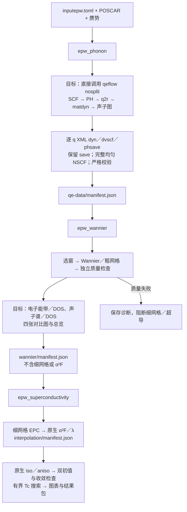

# epwflow

EPW 工作流仅构建三个独立程序：`epw_phonon`、`epw_wannier`、`epw_superconductivity`。配置默认名为 `inputepw.toml`，运行快照为 `input-init.toml`；同目录原有 `input.toml` 继续供 qeflow 使用。

三个入口、脚本生成和粗／细网格清单已接入。第一阶段切换到 qeflow 共享执行库、独立参考的自动生成、第二阶段四类图的自动生成，以及真实原生 iso／aniso Tc 的完整验收仍在实施。当前源码、构建产物和默认安装分别核对，旧安装不能直接使用下列新选项。当前功能见 [Overview](../docs/overview/epwflow/README.md)，整合契约见 [0008 三程序设计](../docs/specs/0008-epwflow-foundation/three-programs.md)。

## 三个阶段



图中“目标”部分尚未全部接入。qeflow 原来就保留 scratch；新增的 `[qe_phonon].retain_epw_data=true` 让 nosplit 生成逐 q 响应势与 XML 动力学矩阵，并校验、归档到 `save/`，详见 [qeflow 手册](../qeflow/README.md#为-epw-保留声子数据)。第一条主路径采用 nosplit，不要求三种 q 方式都完成才交付。

## 生成脚本、检查和执行

先将受测构建目录加入当前终端 PATH，或用三个程序的绝对路径。以下命令在配置所在目录执行；`W` 取配置中的 `work_dir`。示例测试数据放在 `test_auto/MgB2/local_run/` 的编号目录，历史计算目录保留。

```bash
# 默认只固定输入并生成本阶段脚本，不提交、不执行科学程序、不预留预算。
epw_phonon -c inputepw.toml
epw_wannier -c inputepw.toml
epw_superconductivity -c inputepw.toml

# 检查配置，不调用科学程序或 Slurm。
epw_phonon --check -c inputepw.toml --json

# 只准备固定快照。
epw_phonon --prepare-only -c inputepw.toml
```

生成脚本位于 `W/.epwflow/generated/`，依次为 `qe-data.sh`、`interpolation.sh`、`all.sh`。三个脚本分别对应三个程序；最后一个名字来自内部完成边界，执行第三阶段时仍要求前两阶段已有有效完成证据。手工 `sbatch` 这些生成脚本时，计算节点入口先验证脚本和程序身份、前置证据及分配，再登记共享预算。

```bash
# 直接提交第一阶段；成功回执只说明已提交。
epw_phonon -c inputepw.toml -s

# 查询和结算；W 必须替换为实际 work_dir。
epw_phonon --status -w "$W" --refresh --json

# 第一阶段完成后再提交第二阶段，第二阶段完成后再提交第三阶段。
epw_wannier -c inputepw.toml -s
epw_superconductivity -c inputepw.toml -s

# 失败后显式恢复；使用固定快照，不重新读取外部输入。
epw_wannier --resume -w "$W" -s

# 在已经登记的 Slurm 分配内执行；登录节点不能直接执行。
epw_phonon -c inputepw.toml -r
```

内部 `.epwflow/slurm/` 脚本属于已提交的尝试，不能手工重提。科学输出保存在 `W/calculations/<尝试号>/`；恢复沿用原科学目录，已通过阶段重新验哈希，失败现场保留。第二、三阶段缺少前置完成证据时拒绝启动；活动或未知作业不自动重提。

## 数据检查、比较和重绘

`CALC` 是工作流记录中 `calculation_dir` 的实际路径。已有原生数据可只读检查；独立质量参考必须属于当前物理输入，PBE 不能引用旧 LDA 参考。

```bash
epw_phonon --check -w "$CALC" --json
epw_wannier --check -w "$CALC" --json
epw_superconductivity --check -w "$CALC" --json

# 原生比较来源必须已经存在；此命令不生成缺失的科学输出。
epw_wannier --export-comparison "$SOURCES" --output "$COMPARISON"
epw_wannier --collect -w "$CALC"
epw_wannier --plot --results "$RESULTS" --formats png,svg,pdf
epw_wannier --results-check --results "$RESULTS" --json

# 超导结果包也可独立重绘。
epw_superconductivity --plot --results "$RESULTS"

# 阶段导入与共享预算。
epw_phonon --import "$QE_MANIFEST" -c inputepw.toml
epw_phonon --budget status --ledger "$LEDGER" --json
epw_phonon --budget reconcile --ledger "$LEDGER"
```

目前四类比较图可从带哈希的既有来源导出并重绘，自动链仍需接入来源生成。图中 QE 实线先画，EPW 虚线后画；高对称点位于横轴下方，实际 Wannier 外窗和冻结窗用不同颜色标注。严格元素／轨道投影继续暂缓，缺失面板明确标注。

## 测试与科学边界

```bash
bash scripts/build-native.sh test -p qeflow -p epwflow -p qf-input -p qf-phonon --locked --offline
```

隔离进程测试证明接口、阶段顺序、失败阻断和来源校验；不代表真实 MgB₂ 科学验收通过。当前声子最大／RMS 门为 50／20 cm⁻¹，共享预算仍为 8 节点小时／100 GiB，不按阶段重置。已有 LDA 原生线性化 iso 区间不能代替完整双初值非线性与 aniso Tc 验收。实际科学证据及未完成项见 [0015 验收](../docs/specs/0015-epwflow-mgb2-real-validation/acceptance.md) 和 [原生求解源码诊断](../docs/specs/0015-epwflow-mgb2-real-validation/native-solver-source-audit.md)。
